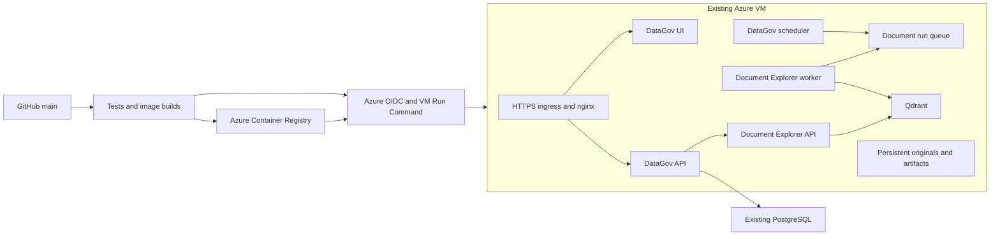

# Azure deployment and service placement

This prepares automatic deployment from `main` to an existing **Linux x86-64 VM running Docker**. It does not provision cloud resources, change the existing VM, or enable GitHub deployment until the one-time setup below is completed. The server's Azure resource identity, capacity, database, ingress and current volume names must be inventoried first.

## Architecture decision

Keep the current service boundaries. DataGov owns authentication, organization/source permissions, schedules, runs, leases, document records, private originals, citation URLs and the browser/Slack experience. Document Explorer owns extraction, chunking, embeddings, retrieval and answer generation. Its API and worker share one independently released image in a separate repository. Qdrant is its vector database, not the authoritative store for document permissions or originals.



| Placement | Use it when | Tradeoff |
|---|---|---|
| All services on the existing VM, separate containers | First rollout, capacity permitting | Lowest operational complexity; one VM remains a shared failure domain |
| Document Explorer API and worker on a second VM, with private networking | Ingestion CPU/memory or independent capacity requirements justify isolation | Additional patching, monitoring, storage and private routing; scheduler stays in DataGov |
| Qdrant Managed Cloud on Azure | Database upgrades, backups, monitoring and availability justify managed service cost | Same Qdrant API; choose region, capacity, access controls and availability configuration deliberately |
| Dedicated VM for Qdrant alone | You need database resource isolation and are prepared to operate it | You still own backup/restore, upgrades and recovery; one extra VM is not high availability |
| Azure AI Search | Corpus evaluation demonstrates a benefit from its retrieval/ranking features | Requires a new adapter and index mapping, plus permission/citation regression testing |

The starting configuration uses the existing VM and local persistent Qdrant. Managed Qdrant is supported through an HTTPS endpoint and key, without engine code changes. Moving an established index is an explicit migration, not a deployment toggle. Do not split the scheduler, permissions or document-serving endpoints into additional services now. A later move of the engine to another VM needs private TLS routing, worker callback routing and an artifact-storage migration; this Compose release does not configure that topology.

Managed Qdrant uses the same search engine and API and supports Azure. It primarily changes operations and availability; hosting alone does not improve retrieval relevance. Azure AI Search supports keyword/vector hybrid retrieval and optional semantic ranking, but any quality claim for our documents requires a representative evaluation. See [Qdrant Managed Cloud](https://qdrant.tech/documentation/cloud/) and [Azure hybrid search](https://learn.microsoft.com/en-us/azure/search/hybrid-search-overview).

## Release behavior

- [.github/workflows/azure-vm.yml](../.github/workflows/azure-vm.yml) tests Django against disposable PostgreSQL, tests/builds the frontend, and checks the deployment controller and both Compose variants. After passing on `main`, it builds three images in ACR and deploys their immutable digests. Pull requests have no Azure deployment credentials.
- The engine repository's `.github/workflows/document-explorer-image.yml` tests its image, publishes to the same ACR, and updates only `document-api` and `document-worker` on `main`. DataGov app releases retain the last successfully deployed engine digest. The scheduler remains in DataGov.
- GitHub authenticates to Azure with OIDC; the VM pulls from ACR with its system-assigned managed identity. There is no SSH password, private SSH key, service-principal client secret, provider key or database password in the release payload.
- Both repositories use a VM lock, record current/previous image state, reject older successful run IDs and require an explicit success marker from the guest. Azure reporting that Run Command completed is not enough to pass a release.
- On the first app deployment, the engine digest comes from `shared/deployment.json`. Subsequent app releases read it from `state.json`. Engine-only releases never run migrations or restart Qdrant.
- Application releases have a **maintenance window**: stop the web/ingestion/scheduler processes, migrate, create the database cache table, collect static assets, then start and wait for health checks. This is not a zero-downtime or high-availability design.
- No command runs `down`, removes volumes, prunes images or reverses migrations. External volumes must already exist; a typo fails rather than silently creating empty storage. No orphan removal is performed, so an existing database container is not deleted.

The [production Compose](../deploy/azure/compose.yml) is separate from development Compose. It has no bundled PostgreSQL or build commands. Only nginx has a published port. The private worker protocol remains blocked at nginx, and originals are not mounted into nginx's public media directory. The [Qdrant overlay](../deploy/azure/compose.qdrant.yml) adds local storage; omit it for a managed cluster.

The frontend image/CI use Node 24 LTS. Its Next.js 15 patch and locked image-processing dependencies were updated during deployment preparation after a production-dependency audit found advisories. The PostCSS override keeps Next's older exact transitive pin on the patched PostCSS 8 API used by the application. CI fails on high/critical production npm advisories. Development-tool advisories are a separate maintenance item; this is not a claim that every build dependency is vulnerability-free.

## One-time Azure and VM setup

1. Find the VM in Azure Portal by its public IP, or use Azure Cloud Shell with the correct subscription:

   ```bash
   az vm list -d --query "[].{VM:name,Group:resourceGroup,IP:publicIps,Size:hardwareProfile.vmSize}" -o table
   ```

   Record VM name, resource group, subscription ID, tenant ID, region and CPU architecture. Confirm the VM agent is healthy and Run Command works. Inspect current Docker services, Compose project labels, mount names, disk capacity, memory use, database connection and HTTPS ingress. Do not print container environments or paste secrets into chat or CI logs.

   For a read-only first inventory, run `bash deploy/azure/inspect-vm.sh SUBSCRIPTION_ID RESOURCE_GROUP VM_NAME` from a checkout in Azure Cloud Shell. This lists registry candidates, the VM identity and a bounded host inventory without reading secrets. Azure Run Command truncates long output; if the VM runs many services, inspect the relevant containers separately before acting.

   ```bash
   uname -m
   docker compose version
   docker ps --format 'table {{.Names}}\t{{.Image}}\t{{.Ports}}'
   docker volume ls
   df -h
   free -h
   ```

2. Use or create an Azure Container Registry near the VM. Record its **actual login server** from `az acr show --name REGISTRY --query loginServer -o tsv`; do not derive it from its name. Keep registry admin credentials disabled. Provisioning is a separate Azure operation and has not been performed by these changes.

3. Enable the VM's system-assigned managed identity and grant pull access to this registry. Use `AcrPull` for registries using legacy registry RBAC, or **Container Registry Repository Reader** for ABAC-enabled registries. The VM needs Docker Engine, Compose **2.30 or later**, Python **3.10 or later**, Azure CLI, and outbound access to ACR, Azure control-plane endpoints, model provider and its database. The current image builds target `linux/amd64`; change both workflows if this VM is ARM64.

4. Create a GitHub OIDC deployment identity for each repository (or deliberately share one with separate federated credentials). Limit trust to the exact repository's `main` branch. Grant registry push permission (`AcrPush`, or the appropriate ABAC repository writer role), registry read permission for the workflow's `az acr show`, and permission to invoke Run Command on **this VM**. A VM-scoped Virtual Machine Contributor role is a practical starting point; a reviewed custom role can narrow it further. Run Command executes as root, so protect `main` and workflow changes accordingly.

   Follow [GitHub OIDC for Azure](https://docs.github.com/en/actions/how-tos/secure-your-work/security-harden-deployments/oidc-in-azure), [VM Run Command](https://learn.microsoft.com/en-us/azure/virtual-machines/linux/run-command), and [ACR managed identity authentication](https://learn.microsoft.com/en-us/azure/container-registry/container-registry-authentication-managed-identity). Verify the repository's actual OIDC subject format: newer/renamed repositories may include immutable repository IDs. Do not copy an assumed `repo:owner/name:ref:refs/heads/main` subject blindly. These workflows do not use GitHub environments and do not require a human production approval after merging.

5. Configure these **GitHub Actions repository variables in both repositories**:

   | Variable | Value |
   |---|---|
   | `AZURE_CLIENT_ID` | OIDC application/managed identity client ID |
   | `AZURE_TENANT_ID` | Directory tenant ID |
   | `AZURE_SUBSCRIPTION_ID` | Subscription ID |
   | `AZURE_RESOURCE_GROUP` | VM resource group |
   | `AZURE_VM_NAME` | VM resource name, not its IP |
   | `ACR_NAME` | Registry resource name |
   | `ACR_LOGIN_SERVER` | Actual registry login server |
   | `AZURE_DEPLOY_ENABLED` | Leave unset until bootstrap; then `true` |

6. On the VM, prepare `/opt/datagov/shared` owned by root, mode `0700`. Copy the templates in [deploy/azure](../deploy/azure/) to `deployment.json`, `backend.env`, `engine.env`, and, for local Qdrant, `qdrant.env`. Secret files must have mode `0600`. Preserve the existing Django secret, DB settings and OAuth/Slack configuration. Fill the new service/worker keys with distinct random values and put matching values in the engine configuration. Runtime env files use literal `KEY=value` values: no surrounding quotes or shell interpolation, and values may contain `$` or `#`.

7. Set the actual existing Compose project and volume names in `deployment.json`. Include both the public host and `web` in `DJANGO_ALLOWED_HOSTS`; engine workers call the private `web` hostname. Confirm the existing PostgreSQL endpoint remains reachable; this production file neither creates nor migrates the database server itself. If the existing DB container is on the current Compose network, keep that project identity. Check production backup/restore and PostgreSQL point-in-time recovery before the first schema migration.

   Map existing static/media/document volumes rather than creating replacements. Only for **new document storage**, explicitly create the names selected in the config:

   ```bash
   docker volume create datagov_platform_document_originals
   docker volume create datagov_platform_document_artifacts
   docker volume create datagov_platform_document_imports
   docker volume create datagov_platform_document_vectors
   ```

   These are example names; use the inventory. An empty engine artifacts volume must be writable by UID/GID `10001`; an empty Docker volume normally receives the image directory's ownership at first mount. Check ownership before ingesting, particularly for restored or nonempty volumes. Originals stay private. Keep Docker's persistent data on durable managed storage and back it up; a volume on a VM disk is persistence, not a backup. Confirm adequate disk/memory headroom and set suitable Compose resource limits based on the VM and initial corpus.

8. Set the public HTTPS hostname and document public URL. The default gateway bind is **127.0.0.1:8080**, for an existing local HTTPS reverse proxy or tunnel. If the current ingress connects to VM port 80, deliberately set `0.0.0.0:80` and restrict access at the network edge to the intended ingress. The packaged nginx config assumes trusted upstream HTTPS termination. Preserve/verify the actual TLS path before enabling public use; do not expose private API, Qdrant or database ports. Existing port-80 containers must be reconciled before first rollout.

## Bootstrap and subsequent releases

1. Merge the tested engine release changes into its `main` while deployment is disabled. Configure its Azure variables; set its `AZURE_DEPLOY_ENABLED=true`; run **Document Explorer Azure release** manually on `main` with **deploy=false**. It tests and publishes the initial image without trying to contact an uninitialized DataGov controller.
2. Copy the emitted `registry/document-explorer@sha256:...` reference into the VM's `shared/deployment.json` as `initial_engine_image`. Finish secret files, storage, HTTPS routing and backups.
3. Merge the DataGov deployment changes into `main` while deployment is disabled. Enable its `AZURE_DEPLOY_ENABLED=true`, then manually run **DataGov checks and Azure release** on `main` for the first rollout. Inspect the run and private VM deployment log.
4. Verify login, existing catalog behavior, document upload/ingestion, a permission-scoped answer, a PDF citation/page link and scheduler activity. Test provider credentials/quota using a small real document and approved model calls; container health does not validate provider billing/quota. Test a Slack DM only when live Slack testing is authorized/configured.
5. Future successful pushes to each repository's `main` deploy automatically. Keep `/v1`, worker callbacks, stored artifact formats and citation identities backward compatible for independent engine updates. Breaking changes require a coordinated release and migration plan.

The VM layout is:

```text
/opt/datagov/
  shared/                       runtime secrets and deployment.json
  releases/app-<run>-<commit>/   controller, Compose files, private log, resulting state
  releases/engine-<run>-<commit>/ private log and resulting state
  current -> releases/app-...   most recent successful app deployment bundle
  state.json                   current successful image digests and release IDs
  previous.json                immediately preceding successful state
  pending.json                 present during/after an unfinished rollout
```

Azure Run Command only permits one active command per VM and returns limited output. The client retries a definite busy rejection, but does **not** automatically retry timeouts or unknown outcomes. Read VM logs first. GitHub per-repository concurrency and the VM lock serialize app/engine releases. An unresolved failure blocks a different component from deploying over a partially updated stack.

## Recovery and changes of storage

Failed migration/readiness means a failed deployment, with `pending.json` and a private log retained. The prior `state.json` is a record of the last successful release, **not proof that its containers are still running**. A failed app release can leave the application stopped until repaired. Do not claim or assume an automatic database rollback.

Prefer correcting the failure and rerunning the same or a newer release from `main`. For a compatible code rollback, revert the code on `main` and let a **new** workflow run publish/deploy it. Old run IDs cannot overwrite a newer successful deployment. Confirm database and artifact format compatibility first; an image rollback does not reverse a migration. Restore from a consistent backup under a maintenance procedure if a data migration cannot be safely used by the previous code.

Storage names, Compose project, registry and local/managed topology are recorded in state. Changing them fails closed during normal releases. To move to managed Qdrant: stop writes, back up all stores, migrate/rebuild the index, validate the new endpoint and tenant-scoped retrieval, update runtime configuration, and deliberately reconcile the recorded topology as part of that operator-controlled maintenance. Do not merely disable the overlay or rename a volume on a populated system. The old Qdrant container/storage are never automatically deleted.

Back up **PostgreSQL + document originals + engine artifacts + import manifests + Qdrant** consistently. PostgreSQL and originals remain required even if Qdrant is managed. Retain versions needed by saved citations, monitor disk use, failed jobs, queue age, provider errors and worker activity. The scheduler container currently has process readiness only; service health is not a full synthetic ingestion check. Set up periodic restore drills and controlled image/log retention; the deployer deliberately performs no automatic pruning.

## Existing colleague index and fresh ingestion

The agreed rollout can download/import documents again and build a **fresh** Document Explorer collection. Keep the colleague's system available until new document counts, access scopes, citations and sample answers are verified. There is no need to modify their running Qdrant as part of deployment.

A Qdrant host migration by itself does not require regenerating embeddings. However, the old engine uses a named `semantic` vector and integer row IDs, with text mappings in a matching external bundle. The DataGov service uses a different collection/payload schema with organization, immutable version and page/chunk metadata. It cannot simply point at the colleague's old collection. Reusing those vectors would require an audited importer and the exact embedding model, dimensions, input title/text formatting and matching bundle; that importer is not included here.

Fresh ingestion creates new embeddings and incurs model usage. Uploads and normalized imported snapshots are implemented now. Live provider download/synchronization adapters and OCR are not included, so deployment does not itself re-download the colleague's entire corpus. Reuse the provider export tools to produce supported snapshots, or implement each authorized connector/credential/ACL mapping before scheduling it in DataGov. Private PDF originals must be uploaded if users need a preserved DataGov PDF viewer; a text-only snapshot cannot recreate the original binary.

## Local verification

```powershell
python -m unittest discover -s deploy/azure/tests -v
python deploy/azure/check_compose.py
```

The controller tests exercise independent releases, storage guards, stale releases, failure before promotion, migration failures and Azure guest-success verification. Compose checks cover local/managed Qdrant and literal secret values using synthetic configuration. They do not establish VM sizing, live Azure identity/registry permissions, production HTTPS routing, provider validity or production deployment success. Those are first-deployment acceptance checks.

Preparation verification on 2026-10-13:

| Check | Result |
|---|---|
| Backend inside its production image, disposable PostgreSQL 18 | 823 tests and 4 subtests passed |
| Frontend after compatible security patches | 212 tests, typecheck and Docker production build passed |
| Deployment controller on Linux | 17 tests passed |
| Production Compose | Local and managed Qdrant configurations validated |
| Actual local production stack | Migrations, cache/static setup, all configured container health checks, worker artifact writes and public login/API routing passed; public internal-worker route returned 404 |
| GitHub workflows | Both passed actionlint; pinned action commits verified against their upstream repositories |
| Image packaging | Backend, frontend and gateway built successfully |
| npm production dependencies | Audit reported zero vulnerabilities after patch updates; development-tool advisories remain |

The isolated stack and its disposable database, network and volumes were removed after verification. No Azure resources, colleague data, live provider calls or production deployment were involved. Local evidence is in ignored `_out/azure-stack/check.log` and `_out/azure-stack/result.json`.
