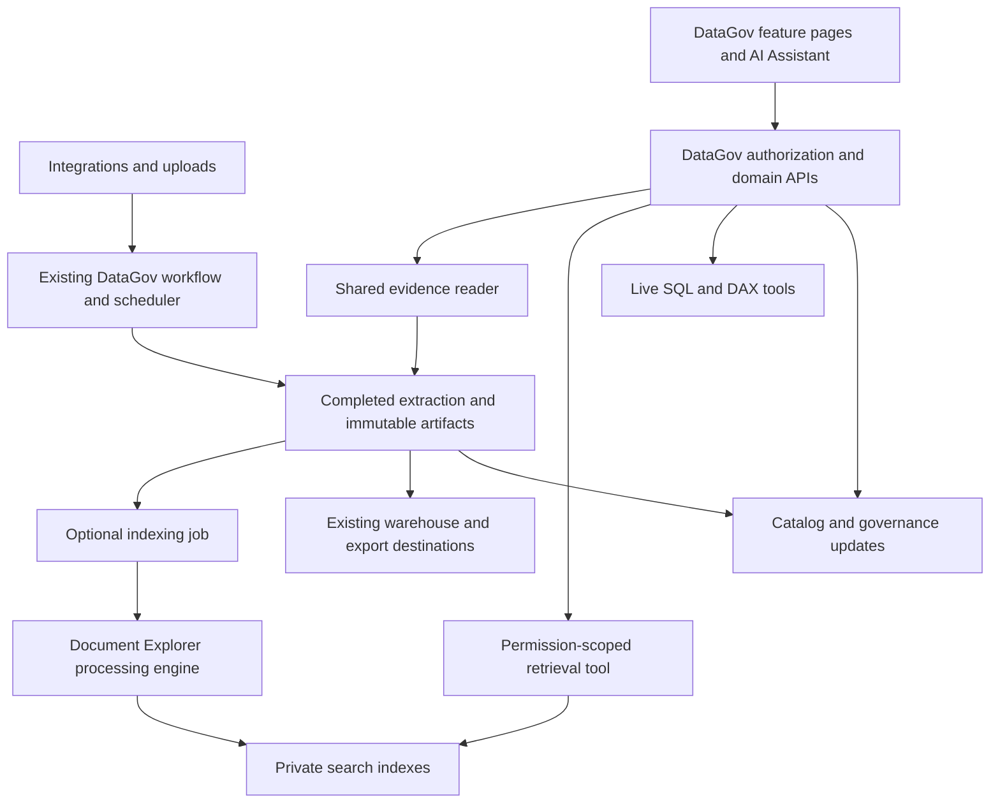

# DataGov: native knowledge and integration architecture

Status: proposed architecture, reviewed against the current repositories on 2026-10-13.
This is a migration plan. The unified integration pipeline, native retrieval tool and shared
reader described below are not yet implemented. Small metadata-query and shared-status
cleanup changes accompany this review; they do not change the product's architecture.

## Recommendation

Keep DataGov as the governance application and evolve its existing modules. Its catalog,
definitions, ownership, lineage, governance tasks, champions, Power BI/dbt analysis,
cleanup tools, dashboards, integrations, exports, Slack and AI capabilities remain first-class
features. The AI uses these features through tools; the application remains usable without AI.

The core concept is a governed resource. A document, metric, report, dbt model, table and
definition each retain their own identity and domain behavior. Search can use a text
representation of any suitable resource, but that representation is a derived index. It
does not replace the structured catalog or become the source of truth for live numbers.

If starting from scratch with these requirements, I would still choose a modular Django
application, one native frontend, a relational governance database and a separately deployed
processing/search engine. For this application, the migration should preserve the existing
implementation and introduce those boundaries incrementally.

## Existing work to reuse

| Existing implementation | Role in the proposed architecture | Change required |
|---|---|---|
| `catalog` models, APIs and feature pages | Authoritative catalog, ownership, definitions, tasks and analytics | Keep; link supporting evidence through stable identifiers |
| `etl/sources/registry.py` | Connector factory and extraction adapters | Extend capabilities and immutable artifact output; preserve Fabric/dbt behavior |
| `etl/destinations/registry.py` and workflow tasks | Destination loading and exports | Keep existing destinations; share the same completed extraction |
| `catalog/integration_tasks.py` and Django-Q | Scheduling, source/workflow coordination and operational history | Add downstream indexing dispatch and stage visibility |
| `knowledge/jobs.py` | Durable index jobs, idempotency, leases, cancellation and atomic publication | Reuse; link jobs to the upstream connection/run/artifact |
| `catalog/tools/agent.py`, provider registry and tool wrappers | Native AI orchestration and live SQL/DAX tools | Add a retrieval provider with server-bound user/org permissions |
| `knowledge` document/version/permission models | Immutable evidence, protected delivery and historical citations | Retain IDs; add explicit integration provenance |
| Existing auth, API client, React Query, dialogs and UI components | One application experience | Consolidate duplicate status and source/run controls |
| Colleague's engine and benchmark suite | Preserved reference implementation | Add adapters and explicit evaluated profiles; protect original files |
| GitHub-to-Azure release workflows | Checked, repeatable deployments and rollback | Keep; add compatibility and acceptance gates |

The current connector registry actually implements Fabric and dbt. Other types in model
choices are not implemented adapters. Documents currently enter through uploads and exported
snapshots. Reprocessing a snapshot is not live synchronization with Confluence/Jira/Drive.

## Proposed flow

DataGov owns users, organizations, source access, schedules, runs, publication and conversation
history. Document Explorer owns extraction from files, chunking, embeddings and retrieval
execution. The latter keeps its own folder/repository, Python runtime, tests and release image
so its stakeholder can update it independently through a versioned service contract.

Keep these as deployment boundaries. Additional services should follow a measured need for
different scaling or release ownership. Catalog, governance, schedules and chat do not each
need a new service merely to make the diagram look tidy.

## One integration model, several capabilities

Each real connection has credentials, provider/account identity, selected scopes, schedules,
access policy and declared capabilities: catalog extraction, file/content ingestion, live
queries, destination export or indexing. An upload collection is a local content source.

Extend the current `IntegrationSource` model through backward-compatible relations and typed
configuration. Add an explicit nullable connection link to existing knowledge collections,
validate organization ownership, and map known imports by reviewed provider identifiers.
Keep ambiguous imports labeled as imports. Folder names and shard names are not connection
identities. Preserve source/document/version IDs and existing ACLs during migration.

A provider can support multiple outputs. A Fabric extraction can update catalog objects and
produce searchable measure definitions. A Confluence connection can produce documents. A
database connection can expose schema and selected textual records while retaining live query
tools. Its full numerical contents should not automatically become embeddings.

Use existing domain models as the authoritative records. Start with a thin typed resource
reference and evidence relation rather than migrating every catalog object and document into
one large generic JSON table. Scope uniqueness by organization, connection and provider ID.

## Reuse the existing pipeline safely

1. **Extract once.** A connector produces a manifest containing stable identities, revisions,
   content hashes, original references, access provenance and complete/incremental enumeration
   status. Preserve an immutable artifact before temporary files are removed.
2. **Publish extraction completion.** Record successful upstream state and durable downstream
   indexing intent together. Reuse `IngestionRun` and a unique upstream-run/profile key for
   dispatch so a crash or repeated delivery cannot lose or duplicate the indexing stage.
3. **Run independent outputs.** Catalog loading, configured destinations and indexing consume
   that artifact. Their statuses remain separate in the existing workflow view.
4. **Retry the failed stage.** A failed embedding request reuses extraction and completed
   chunks. An indexing failure leaves the previous published version available. Do not rerun
   a successful provider download or warehouse load solely to recover embeddings.
5. **Publish only complete evidence.** Keep current lease fencing, transaction boundaries and
   cancellation checks. Delete/unpublish records only after authoritative enumeration or an
   explicit deletion event, never because a provider request failed halfway through.

The current ETL writes to shared static directories protected by
`catalog/services/pipeline_lock.py`, then cleans them in `finally`. Retain that lock while
introducing durable artifacts. Later move each extraction to its own run directory and remove
the global lock only after concurrent extraction/load/cleanup tests prove isolation. Copying
these files to an asynchronous worker after cleanup would be a correctness bug.

Keep one scheduling owner. Once a connection owns a collection's refresh, disable the old
collection schedule. Reuse Django-Q for orchestration and the existing database-backed leased
engine jobs. Shared provider concurrency limits, bounded backoff and status-aware retries
belong here. Authentication/configuration failures must be distinguished from rate limits;
do not blindly retry paid answer generation after an ambiguous timeout.

Separate pausing synchronization from revoking content access. Existing inactive collections
must remain inaccessible during that migration; a new pause control must not restore them.

## Native AI and evidence

Keep the current Pydantic AI agent and its catalog, dbt, Power BI and BigQuery tools. Add a
bounded `search_evidence` provider using the engine's `/v1/search` contract. Resolve the user,
organization and source permissions in application code before the tool executes. The model
must not supply a broader authorization scope. Recheck permissions before evidence is returned
or an answer/history entry is exposed.

The primary answer is generated in the existing agent. Calling another complete chat agent
as its retrieval tool would duplicate orchestration, model calls and conversation state.
Retain the old document-answer endpoint and sessions during migration; remove them only when
saved conversations and citation links have compatible readers.

Use tool-specific behavior: document search for policies and explanations; typed catalog APIs
for ownership, definitions and lineage; live SQL/DAX for current numerical facts. Mixed questions
can use several tools in one conversation. Every cited document passage retains resource ID,
version ID, chunk ID, page/section and original URL. Live query results carry their own query
time/source provenance rather than an invented PDF citation.

Reuse bounded tool-call wrappers, but audit logging: full retrieved passages must not leak into
generic queue/debug output. Preserve feature flags and existing limits for each provider.

## Product experience

- Keep all current governance/catalog/analytics navigation and direct workflows.
- Extend Integrations with connection-scoped Overview, Data & documents, Runs and Settings.
  Group Confluence spaces, Jira projects and imported collections under their actual connection.
  Show storage/indexing shards only in technical diagnostics. Provide uploads here.
- Give authorized readers access to content without granting integration administration. The
  current Integrations page is admin-only, so its permission model needs separating first.
- Use the same evidence reader from AI answers, catalog assets, definitions and governance
  tasks. On desktop it opens beside the working page with a resizable pane; chat remains usable.
  On narrow screens it becomes a full-page view. Preserve canonical `/knowledge/documents/...`
  links, including copied links and links from Slack.
- Render PDFs through a page/text-layer viewer supporting zoom, selection and page navigation.
  Persist real page coordinates or normalized text offsets to highlight the exact cited version.
  A citation excerpt alone is not an inline highlight. Show an explicit fallback when an exact
  match is unavailable. OCR/scanned documents need a tested parser before claiming support.
- Remove the duplicate top-level Document Explorer navigation and mandatory Catalog/Documents
  chat switch only once browsing, uploads, history and evidence are reachable in the new flow.

For example, a governed revenue metric keeps its definition, owner, lineage and report usage.
It can also link to a policy document. A user can inspect either in the normal app or ask the
AI to explain a number using the definition, supporting policy and a live DAX/SQL result.

## Existing frameworks: use components where they remove work

These products overlap with ingestion and AI, but adopting them does not migrate DataGov's
governance model or enforce its permissions automatically. The fit assessments below are design
judgments based on the inspected code and the linked official documentation, not benchmarks.

| Option | Useful capability | Fit for this application |
|---|---|---|
| Pydantic AI, already installed | Agent tools and typed orchestration | Keep as the native AI layer; extend its existing provider registry |
| LlamaIndex | Readers, document transformations, ingestion caching and deduplication | First candidate for reusable ingestion components where the current adapters are incomplete |
| Haystack | Explicit component pipelines for indexing and querying | Candidate if the engine needs a maintained pipeline graph; wrap the colleague's components and benchmark before changing behavior |
| Dify / RAGFlow | Broader ingestion, retrieval, agent and management platforms | Consider behind an adapter only if their managed workflow capabilities remove more work than the identity, evidence, operations and state integration introduces |

My recommendation now is to keep the current application/agent/engine boundary and evaluate
one narrow library-backed connector/parser against the existing implementation. Avoid adding
both LlamaIndex and Haystack as parallel orchestration layers. A framework trial must prove
less maintenance or better measured extraction/retrieval while preserving ACLs, versioned
evidence, retries and stable links. Do not change chunking or embeddings merely as a side effect
of adopting a framework. No library replacement has been selected or installed in this review.

Official references checked on 2026-10-13:

- [Pydantic AI tools](https://pydantic.dev/docs/ai/tools-toolsets/tools/) documents extending an agent through function tools.
- [LlamaIndex readers](https://developers.llamaindex.ai/python/framework/module_guides/loading/connector/) and [ingestion](https://developers.llamaindex.ai/python/framework/module_guides/loading/ingestion_pipeline/) cover reusable source readers, transformations and ingestion state.
- [Haystack pipelines](https://docs.haystack.deepset.ai/docs/creating-pipelines) support indexing/query graphs; [metadata filtering](https://docs.haystack.deepset.ai/docs/metadata-filtering) is available at retrieval time.
- [Dify](https://github.com/langgenius/dify) combines workflows, RAG and agents. [RAGFlow ingestion](https://ragflow.io/docs/v1.0.0-rc1/category/ingestion-pipeline) describes parsing, chunking, transformation and indexing; its prerelease documentation is not a deployment-version recommendation.

## Storage, efficiency and operations

Keep application PostgreSQL authoritative for governance, permissions and publication. Keep
Qdrant as a replaceable derived vector index. Preserve the existing corpus and current private
volumes while introducing coordinated backup/restore and a private object-storage adapter for
originals/manifests. A later Azure Blob migration must copy, checksum-verify and switch
references while old evidence links remain valid. Existing GCS exports remain useful source
artifacts; they should not trigger an unnecessary full re-download.

Keep the current VM allocation for the first validated release; measure peak indexing/query
memory, disk growth and latency before moving workloads. Managed Qdrant or a dedicated engine
VM can change operations/scaling without forcing a DataGov API redesign. A storage provider
change by itself does not establish better retrieval quality.

Metadata pages should fetch metadata, paginate on the server and avoid one query per source.
Permission-filtered search must remain correct as the corpus grows. The current allowlist is
bounded at 100,000 versions. At larger scale evaluate indexed access-scope identifiers and
publication generations, with revocation applied before evidence reaches the model; do not
remove permission filtering to improve latency.

Keep version fingerprints for parser, redaction, chunking, embedding model/dimensions and
ranking settings. Reuse embeddings only when the representation is compatible. Retain a
separate evaluated index generation when any of those change. Reconcile orphan derived points
against immutable published manifests, with dry-run inventory and recovery backups.

## Delivery plan and gates

| Stage | Deliverable | Required preservation/acceptance evidence |
|---|---|---|
| 0. Baseline and cleanup | Feature/route inventory, compatibility guard, metadata-query fixes, corpus consistency | Original checkout unchanged; original 298-file baseline protected; DB/artifacts/lexical/vector counts agree |
| 1. Integration provenance | Add connection/run/artifact relations and a read-only grouped content API | All existing IDs, source ACLs, schedules and exports preserved; readers do not gain admin access |
| 2. Shared ingestion handoff | Optional indexing stage consumes completed Fabric/dbt artifacts; upload/snapshot adapters use the same contract | Indexing disabled preserves old runs; no duplicate provider fetches; crash/retry/cancel and partial enumeration tests |
| 3. Native AI retrieval | New provider in the existing agent, mixed evidence and live-data questions | Existing SQL/DAX/catalog tests pass; revocation/history tests; capped comparative retrieval evaluation |
| 4. Shared reader and navigation | Integration content/uploads, working pane, PDF/text highlights, stable Slack links | Browser checks for exact version/page/highlight, composer interaction, mobile, login and denied access |
| 5. Component replacement and operations | Optional selected framework component, retention, coordinated restore and capacity checks | Demonstrated maintenance/quality benefit; rollback to old profile; restore into an empty environment |

Stages 1-4 are small additive releases behind feature flags, not a replacement application.
Keep old routes/API shapes until their consumers migrate. Rollback switches dispatch/provider/UI
flags and compatible image revisions; it does not drop tables, wipe indexes or restore revoked
access. Each stage requires tests of existing catalog, governance, lineage, ETL/destinations,
auth and chat as well as its new behavior.

The colleague's original checkout remains at `b7d806401dc79019cd691c98b884c16dfb585cda`.
Source preservation is verified separately from retrieval quality. DataGov currently uses a
different permission-scoped retrieval path, so legacy benchmark scores cannot be advertised
as DataGov scores. Record corpus digest, model configuration, index profile, expected evidence,
latency and cost for comparisons. Offline checks and a single live answer test do not establish
quality parity across the corpus.
