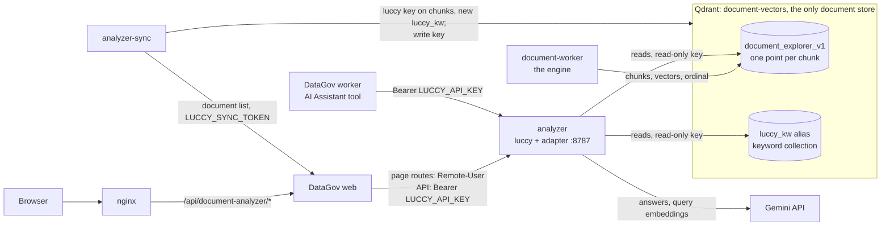
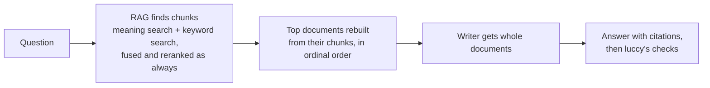

# Document Analyzer

**Luccy (Beta)** is the independent Document Analyzer app. It runs **luccy**, the colleagues' document question-answering app
([`welcome-travel-technologies/luccy`](https://github.com/welcome-travel-technologies/luccy)),
inside DataGov. It answers questions about the company's documents and cites them.

It reads **DataGov's own documents**, the ones the [Document Explorer](document-explorer.md)
has already indexed. There is no second copy of the documents, no page files on disk, no data
volume and no second embedding of the corpus. Qdrant, the Document Explorer's vector database,
is the only place the documents live.

- **The initial rollout is page-only.** `LUCCY_CHAT_ENABLED=False` (the default)
  disables document search for every user in the assistant and documents-mode chats.
  The standalone `/document-analyzer` page remains available to authorized members.
  The protected admin comparison still exercises the full chat integration without
  enabling it for users or changing their preferences.
- **Open the independent app in a new window.** **Luccy (Beta)** is the last entry
  in the Analytics menu. It opens in its own tab, without DataGov's sidebar, and shows
  **luccy's own chat page** exactly as the standalone app does (its look, chats and history,
  sources, feedback) behind DataGov's sign-in and access checks. The comparison is an
  operator script; it has no frontend, menu item or browser results endpoint.
- **When chat is enabled, the Document Analyzer answers every document question in DataGov**: on its
  `/document-analyzer` page, in the AI Assistant chat (its only document tool), in earlier
  documents-mode chats and in Slack's `documents:` direct messages. The Document Explorer
  engine only indexes and stores the documents; DataGov has no other document answering path.
- **DataGov** provides sign-in and the access rules. A chat turn that used only the analyzer,
  a documents-mode chat and a Slack answer show luccy's answer word for word.
- **luccy** does what it always did: it routes the question, plans, retrieves, reranks, writes
  the answer and checks it.
- Everything runs next to DataGov: on a Compose host, or on the Azure VM through the release
  controller.

This runbook is for DataGov operators and for the luccy authors. In it, *luccy* means that
repository, *the engine* means the Document Explorer engine, and *the adapter* means
`analyzer/luccy_qdrant/` in this repository.

## How it works



What lives in Qdrant:

| Name | Written by | What it holds |
|---|---|---|
| `document_explorer_v1` | the engine, when it indexes a document | One point per chunk: luccy's embedding of the chunk, its text, title, section, source link, organization and version ids, and `ordinal`, the chunk's place in its document. |
| `luccy` key on those points | `analyzer-sync` | luccy's metadata for the chunk. Only points that carry it belong to luccy's corpus. |
| `luccy_kw` | `analyzer-sync` | An alias to `luccy_kw_<stamp>`: luccy's keyword (BM25) vectors for the same point ids. A `luccy_kwdf_<stamp>` collection beside it holds the term statistics luccy's keyword scorer needs. |

How an answer is found:



1. luccy searches the chunks: meaning search on the vectors in `document_explorer_v1` and
   keyword search on `luccy_kw`, then fuses and reranks them as it always has.
2. The best documents are rebuilt from their chunks, put back in `ordinal` order with the
   engine's own `document_explorer.stitch.stitch_document`.
3. luccy's writer gets those whole documents, exactly as it used to get whole page files, and
   writes the answer with its citations. luccy's checks run after it, as before.

What DataGov does around each answer:

- **Luccy (Beta) is luccy's own page behind DataGov's sign-in gate.** The analyzer runs with
  `LUCCY_DEV_UI=1`, which opens luccy's chat page (`serving/chat.html`) and its page routes.
  `/document-analyzer` shows that page in a full-window frame from
  `/api/document-analyzer/luccy/` (`backend/app/document_analyzer/page_gate.py`). For every
  request the gate checks the DataGov session and analyzer access, then relays it with
  `Remote-User` set to the person's email (else their username, else `datagov-<user id>`) and
  no cookie or origin of the browser. luccy saves each person's chats under that name in the
  analyzer's logs volume.
- **The gate relays only luccy's page routes** (the page, its fonts, chats, ask/stream,
  cancel, feedback, notes, documents, records); anything else answers 404. Writes must come
  from DataGov's own origin (the page sends no CSRF token, so the `Origin` check stands in for
  it), and each question (`POST chats/<id>/ask`) counts against `LUCCY_MAX_ASKS_PER_HOUR`
  per person (60; a question luccy refuses does not count).
- **The AI Assistant tool** calls luccy's bearer API with `Authorization: Bearer
  LUCCY_API_KEY` and `Remote-User: datagov-<user id>`; DataGov keeps that chat's history and
  sends it with each question.
- **Answers stream as server-sent events.** luccy sends a `: ping` every 15 s. The nginx
  location for `/api/document-analyzer/luccy/` passes each event through at once, with a
  360 s read timeout. DataGov waits up to `LUCCY_STREAM_TIMEOUT` (330 s).
- **luccy's own messages reach the reader**, for example a reached spend cap (429) or "busy"
  (503 with `Retry-After`). The AI Assistant tool waits out a "busy" of up to 15 s once, and
  never asks past its chat turn's own time limit.

## Why luccy's algorithm is unchanged

- **luccy's code is untouched.** The analyzer image is built `FROM` luccy's published serving
  image (`LUCCY_IMAGE`, `analyzer/Dockerfile`). The adapter is a separate Python package next to
  it. No luccy file is edited, and luccy's web app is imported as it is.
- **Only storage changes.** luccy normally reads an index bundle from disk: page files, its
  keyword files, its vectors and its catalog. The adapter answers exactly those reads from
  Qdrant. It does so by replacing a fixed, listed set of luccy functions before luccy's app is
  imported (`hooks.py`); `analyzer/luccy_qdrant/STORAGE_MAP.md` lists every storage read and how
  it is served. Routing, planning, fusion, reranking, the writer, its prompts and its checks
  are luccy's own code.
- **Pinned to the reviewed luccy source.** Every replaced function is pinned to a hash of the
  luccy source it was written against (`pins.py`, luccy 0.19.1 today). The image build checks
  the pins (`python -m luccy_qdrant.hooks --app` in `analyzer/Dockerfile`), so an image whose
  luccy differs is never built and a luccy change can never run unreviewed. A new luccy
  version means re-reviewing the hooks and re-pinning them.
- **Same chunks, same vectors.** The engine cuts documents with luccy's own chunker
  (`retrieve.chunk_body`) and embeds them with luccy's own embedder. The vectors luccy searches
  are the ones it would have made itself.
- **Equality test.** The adapter's tests build one corpus both ways, as luccy's file bundle and
  as the Qdrant collections, and require luccy's retrieval to return the same results from
  both.
- **What can still differ.** The answer text comes from a language model, so two runs of the
  same question can be worded differently. And the corpus is the documents DataGov has
  imported, so luccy answers from DataGov's collections, not from luccy's own crawl. The
  comparison below measures the result on luccy's whole golden set, against luccy's own
  recorded score on it.

## What runs where

`docker-compose.analyzer.yml` sits on top of the Document Explorer overlay and reuses its
Qdrant service, `document-vectors`: the sync writes with its key `DOCUMENT_EXPLORER_QDRANT_KEY`,
the analyzer searches with its read-only key `DOCUMENT_EXPLORER_QDRANT_READ_ONLY_KEY`.

| Service | What it is |
|---|---|
| `analyzer` | luccy's web app on the adapter (`python -m luccy_qdrant.serve`), on 8787 inside the Compose networks. No host port. `mem_limit: 6g`, `stop_grace_period: 310s`, two answers at once. |
| `analyzer-sync` | One-off job (profile `analyzer-jobs`): `python -m luccy_qdrant.sync`. Builds `luccy_kw` and the `luccy` keys from DataGov's document list. |
| `analyzer-compare` | One-off job (profile `analyzer-jobs`): `python -m luccy_qdrant.compare`, the luccy against DataGov comparison. `stop_grace_period: 600s`: one question takes minutes across three arms, and a stop lets the questions in flight finish. |
| `web`, `worker` | DataGov. The overlay adds the `LUCCY_*` settings and joins them to the `analyzer` network. |
| `document-vectors` | The Document Explorer's Qdrant, also joined to the `analyzer-vectors` network. With the read-only key set it accepts a second key that may search but never write. |

- **Two private networks.** `analyzer` joins `web`, `worker` and the luccy containers, and is
  their way out to Gemini. `analyzer-vectors` is internal (no way out) and joins Qdrant to
  `analyzer` and `analyzer-sync` only. luccy is not on DataGov's `default` network, so it does
  not resolve the database, nginx, the frontend or the engine's API by name.
- **No database credentials.** No luccy container is given a database host, user or password;
  everything it learns about DataGov comes through DataGov's API. That is not network
  isolation: the `analyzer` network has a way out, so it also reaches ports published on the
  Docker host. The development `docker-compose.yml` publishes `db` on `5432:5432` for psql
  and DBeaver. **Do not run the analyzer overlay on a host whose database port is published**,
  or remove that mapping first (delete the `ports:` of `db`, or add an override file with
  `services: {db: {ports: !reset []}}`).
- **One volume, for logs only.** `analyzer_logs` at `/app/serving/logs` holds luccy's answer
  records, feedback, spend ledger and each person's saved chats. It holds no document data.
- **luccy talks REST to Qdrant** on 6333: `analyzer` with Qdrant's read-only key, which Qdrant
  answers with 403 for any write; `analyzer-sync` with the write key. `analyzer-compare` gets
  no Qdrant key and is not on `analyzer-vectors`.
- **Hardened containers.** Every luccy container drops all Linux capabilities and runs with
  `no-new-privileges`. Only `analyzer` sets `LUCCY_DEV_UI=1` (luccy's chat page); with no
  host port, people reach it only through DataGov's gate.

## Set it up with Compose

The Document Explorer overlay must already run, with the organization's documents indexed.
Run every command from the DataGov checkout:

```bash
C="docker compose --env-file .env.documents --env-file .env.analyzer -f docker-compose.yml \
   -f docker-compose.documents.yml -f docker-compose.analyzer.yml"
```

### 1. Pick the luccy image

Use the luccy version the adapter is pinned to (`LUCCY_VERSION` in
`analyzer/luccy_qdrant/pins.py`). Pin it by digest,
`ghcr.io/welcome-travel-technologies/luccy@sha256:<digest>`, or build `luccy:local` in the
luccy repository with `docker compose build`.

### 2. Write `.env.analyzer`, and the read-only key in `.env.documents`

```bash
cp .env.analyzer.sample .env.analyzer && chmod 600 .env.analyzer   # ignored by git
openssl rand -hex 32    # once each: LUCCY_API_KEY, LUCCY_SYNC_TOKEN (LUCCY_EVAL_TOKEN for the comparison)
openssl rand -hex 32    # once more: DOCUMENT_EXPLORER_QDRANT_READ_ONLY_KEY in .env.documents
```

`DOCUMENT_EXPLORER_QDRANT_READ_ONLY_KEY` goes in `.env.documents`, next to the Qdrant key it
must differ from. The Document Explorer overlay hands it to Qdrant as
`QDRANT__SERVICE__READ_ONLY_API_KEY`; empty (its default) leaves Qdrant exactly as before (Qdrant
logs once that the read-only key is empty and treated as unset). The analyzer overlay
requires it and gives it to the `analyzer` container as `LUCCY_QDRANT_API_KEY`.

| Variable | Value |
|---|---|
| `LUCCY_IMAGE` | The image from step 1 (default `luccy:local`). |
| `LUCCY_API_KEY` | Random. DataGov sends it to luccy; luccy checks it. The comparison sends it too (arms A and A2). |
| `LUCCY_SYNC_TOKEN` | Random, different. The sync job sends it to DataGov to read the document list; the comparison reads the same list with it. |
| `LUCCY_EVAL_TOKEN` | Random, different. Only for the comparison, which sends it to DataGov. |
| `LUCCY_GEMINI_API_KEY` | luccy's Gemini key (its `SERVING_GEMINI_API_KEY`). It pays for answers, query embeddings and the comparison's judge. |
| `LUCCY_ORGANIZATION_ID` | The DataGov organization (pk) whose members may use the analyzer and whose documents it reads (DataGov's setting; luccy learns the organization from DataGov's document list): `$C exec web python manage.py shell -c "from catalog.models import Organization as O; print(list(O.objects.values_list('pk','name')))"` |
| `LUCCY_EVAL_ENABLED`, `LUCCY_EVAL_USER_ID` | Only for the comparison. See [Run the comparison](#run-the-comparison). |
| `LUCCY_LIVE_UPLOAD_URL_TEMPLATE` | Optional, read by the sync. Where luccy links uploaded documents, which have no source URL: DataGov's reader, e.g. `https://datagov.example.com/knowledge/documents/{document_id}`. Empty makes luccy cite uploads with its Google Drive title search. A change applies on the next `analyzer-sync --force`. |
| `LUCCY_MAX_CONCURRENT_ANSWERS`, `LUCCY_SPEND_DAY_CAP_USD`, `LUCCY_SPEND_MONTH_CAP_USD` | Optional: 2 answers at once, $25 a day, $300 a month. |

Compose refuses to start while `LUCCY_API_KEY`, `LUCCY_SYNC_TOKEN`, `LUCCY_GEMINI_API_KEY` or
`LUCCY_ORGANIZATION_ID` is empty, and says which. Each token must be 32+ characters, and the
sync and eval tokens must differ from the others: DataGov closes the endpoints of a weak or
shared one (404, and its log says why) and keeps the page and the assistant tool, which need
only `LUCCY_API_KEY`. `.env.analyzer` wins over `backend/.env` for the settings above. Each
luccy container gets only the secrets it needs; [Who holds which
secret](#who-holds-which-secret) lists them.

### 3. One-time steps, in this order

```bash
# a. Give chunks indexed before the engine recorded their order an `ordinal` (new chunks get one).
$C exec document-worker python -m document_explorer.ordinals backfill
# b. Build the analyzer image, then the keyword collection and the `luccy` keys.
$C build analyzer
$C --profile analyzer-jobs run --rm analyzer-sync
# c. Start the analyzer (and give web and worker their new settings).
$C up -d
```

- **The backfill** needs an engine image that has the `ordinals` command. Without ordinals,
  whole documents cannot be rebuilt in order.
- **The first sync** also restarts `web` and the Qdrant service once, so that they join the
  new networks, Qdrant gets its read-only key and `web` gets its `LUCCY_*` settings. That
  takes a few seconds.
- **The sync reads DataGov's document list** (identities only, from the collections every
  member may read), adds the `luccy` key to those chunks, builds a new `luccy_kw_<stamp>` and
  points the `luccy_kw` alias at it. It embeds nothing and writes no file. A version it
  cannot use (listed twice, clashing chunk positions, points that vanish mid-run) is left
  out and listed under `skipped_versions` in its report; the rest is published.
- **`up` starts the analyzer.** It loads its models before `/health` turns 200; its health
  check allows 300 s.

### 4. Check

```bash
$C ps analyzer                       # (healthy) once luccy answers /health; the body says if it can answer
$C exec analyzer python -c "import urllib.request as u, urllib.error as e
try: print(u.urlopen('http://127.0.0.1:8787/health', timeout=5).read().decode())
except e.HTTPError as x: print(x.code, x.read().decode())"
```

As a member of the organization, `GET /api/document-analyzer/status/` should say the analyzer
is available and healthy. Open **Luccy (Beta)** at the bottom of the Analytics menu;
luccy's own chat page opens in a new window.

## Keep it in sync

The engine adds and replaces documents whenever DataGov's document runs finish. luccy sees a
change only after the next sync. Run the sync on a timer, every 3 hours. It asks DataGov for a
digest first and exits quickly when nothing changed; documents that had no chunks yet are
picked up as soon as the engine has indexed them.

On a Compose host, as a cron line (`--no-deps`, so a timer never restarts DataGov's services):

```cron
0 */3 * * * cd /opt/datagov/app && flock -n /tmp/datagov-analyzer-sync.lock docker compose --env-file .env.documents --env-file .env.analyzer -f docker-compose.yml -f docker-compose.documents.yml -f docker-compose.analyzer.yml --profile analyzer-jobs run --rm --no-deps -T analyzer-sync >> /var/log/datagov-analyzer-sync.log 2>&1
```

On the Azure VM, see [Enable it in Azure](#enable-it-in-azure).

When a sync moves the `luccy_kw` alias, the analyzer notices it the way luccy notices a new
bundle: it finishes the answers in flight, then its worker restarts and loads the new corpus.
Meanwhile new questions get 503 with `Retry-After`, and DataGov shows luccy's message.

## Enable it in Azure

The release controller (`deploy/azure/deploy.py`) runs the analyzer only when
`deployment.json` turns it on. Without that, every release renders and runs exactly what it
did before; a test proves the rendered Compose is byte-identical.

1. **Import the luccy image into ACR**, pinned by digest, once per luccy version:

   ```bash
   az acr import --name <ACR_NAME> --source ghcr.io/welcome-travel-technologies/luccy@sha256:<digest> \
     --image luccy:<version> --username <github user> --password <token with read:packages>
   ```

2. **Set two GitHub repository variables**: `ANALYZER_IMAGE_ENABLED=true` and
   `LUCCY_IMAGE=<ACR_LOGIN_SERVER>/luccy@sha256:<digest>`. From then on, every `main` release
   builds `datagov-document-analyzer` from `analyzer/` and deploys its digest with the app.
   Without the variable, CI builds nothing extra.
3. **Prepare the VM** (as root). The env templates are in the repository's `deploy/azure/`, not
   in the release bundle:

   ```bash
   docker volume create datagov_platform_analyzer_logs
   cd /opt/datagov/shared
   for f in analyzer analyzer-sync analyzer-compare; do install -m 600 /dev/null $f.env; done
   # then paste each deploy/azure/<file>.example into its file and fill it
   ```

   Each luccy container reads only its own file, and the release refuses a file that holds
   another container's secret (by name or by value):

   - `analyzer.env` (the `analyzer` service): `LUCCY_API_KEY`, luccy's
     `SERVING_GEMINI_API_KEY`, the engine's Qdrant URL as `LUCCY_QDRANT_URL`, and Qdrant's
     read-only key as `LUCCY_QDRANT_API_KEY`.
   - `analyzer-sync.env` (the sync job): `LUCCY_SYNC_TOKEN`, `LUCCY_QDRANT_URL`, and the
     engine's `QDRANT_API_KEY` (the write key) as `LUCCY_QDRANT_SYNC_API_KEY`.
   - `analyzer-compare.env` (the comparison job, only while `LUCCY_EVAL_ENABLED=True`):
     `LUCCY_API_KEY`, `LUCCY_EVAL_TOKEN`, `LUCCY_SYNC_TOKEN` and the judge's
     `SERVING_GEMINI_API_KEY`. No Qdrant key.
   - **The read-only key**, with local Qdrant: add `QDRANT__SERVICE__READ_ONLY_API_KEY` (a new
     `openssl rand -hex 32`) to `qdrant.env`; the release then requires it as
     `LUCCY_QDRANT_API_KEY` in `analyzer.env`. Without it the release accepts the engine's key
     there, but that key can write. With managed Qdrant, create a read-only key in the cluster and use
     that; the release cannot check it, and luccy's `/health` reports a refused key.
   - In `backend.env`, set `LUCCY_ENABLED=True`, the same tokens and `LUCCY_ORGANIZATION_ID`
     (see `backend.env.example`). `compose.analyzer.yml` sets `LUCCY_API_URL` itself.
4. **Turn it on** in `/opt/datagov/shared/deployment.json`:

   ```json
   "analyzer": {"enabled": true, "logs_volume": "datagov_platform_analyzer_logs"}
   ```

5. **Release** (the next push to `main`, or **Run workflow** on `main`). The controller then:
   - checks the luccy files before touching anything (`analyzer-compare.env` and the eval
     token only while `LUCCY_EVAL_ENABLED=True`): mode 0600; tokens of 32+ characters that
     differ from each other and from DataGov's keys, each the same as in `backend.env`; each
     file holding only its own container's secrets; the sync's key equal to the engine's
     write key; the analyzer's key equal to the read-only key when `qdrant.env` sets one
     (otherwise the engine's key); the engine's Qdrant URL and chunk collection; 1 to 3
     answers at once when set;
   - adds `compose.analyzer.yml`, pulls the analyzer image, checks the logs volume exists;
   - starts the analyzer after DataGov is healthy again, and waits until luccy's web process
     answers `/health`. That answer may still be "unhealthy" before the first sync (step 6):
     the release only proves luccy started. luccy's `/health` body and DataGov's status page
     say whether it can answer. An analyzer that does not come up never fails the release:
     it says `analyzer not healthy; DataGov release complete` and finishes.

   If CI cannot build the analyzer image (a bad `LUCCY_IMAGE`, or pins that no longer match),
   it warns and releases DataGov without it; the VM keeps the analyzer image it runs.

   Switching the analyzer on or off is not a storage migration: it keeps no document data.
6. **Run the one-time jobs** on the VM, as root, in this order:

   ```bash
   python3 /opt/datagov/current/deploy.py --job backfill-ordinals
   python3 /opt/datagov/current/deploy.py --job analyzer-sync
   ```

   Jobs run against the last successful release, as one-off containers. They never restart a
   release's services, refuse while a release is unfinished, and skip a run while the same job
   is still running.
7. **Install the timer** for the sync, every 3 hours:

   ```ini
   # /etc/systemd/system/datagov-analyzer-sync.service
   [Unit]
   Description=DataGov Document Analyzer sync
   [Service]
   Type=oneshot
   ExecStart=/usr/bin/python3 /opt/datagov/current/deploy.py --job analyzer-sync

   # /etc/systemd/system/datagov-analyzer-sync.timer
   [Unit]
   Description=Run the Document Analyzer sync every 3 hours
   [Timer]
   OnCalendar=*-*-* 00/3:00:00
   Persistent=true
   [Install]
   WantedBy=timers.target
   ```

   Then `systemctl daemon-reload && systemctl enable --now datagov-analyzer-sync.timer`. Its
   output is in `journalctl -u datagov-analyzer-sync`. A cron line works too:
   `0 */3 * * * root /usr/bin/python3 /opt/datagov/current/deploy.py --job analyzer-sync`.

On the VM, luccy runs on the project's default network like DataGov's other services. It is
not given database credentials (the database is external and needs its own), and it reaches
Qdrant only with the keys in its own file. The Compose host overlay above puts it on its own
networks instead.

## Security

### Internal endpoints

The engine's workers call `/api/knowledge/internal/`; the sync and the comparison call
`/api/document-analyzer/internal/`. All of them reach `web:8000` directly, with their own
tokens. From the public edge those paths answer 404, in three independent layers:

1. **nginx** answers 404 itself, in any spelling: one case-insensitive regex location,
   `~* ^/+api/+(document-analyzer|knowledge)/+internal(/|$)`, matched on nginx's decoded and
   normalized path, so upper or mixed case, repeated slashes, `%`-escapes and `.`/`..`
   segments do not slip past. It is the first regex in `nginx.conf` and no `^~` prefix covers
   `/api/`, so it wins over `location /api/` and the Luccy page location.
2. **The frontend** never proxies a path with an `internal` segment, in any letter case or
   percent-encoding, so a private path that reaches the SPA in any spelling cannot reach
   Django through a Next.js rewrite.
3. **Django** answers 404 to any request for those paths that came through a proxy (it carries
   `X-Forwarded-For` or another proxy header), before authentication and whatever token it
   carries. The legitimate callers send none.

**Every release checks it**: before promoting, `deploy.py` probes both prefixes over public
HTTPS in lower, upper and mixed case (`INTERNAL_PROBES`) and fails unless each answers 404.
CI also runs `deploy/azure/check_gateway.py`: it starts the gateway's nginx with `nginx.conf`
against a dummy upstream and proves that every probed spelling gets nginx's own 404 while the
API, the Luccy page routes and the SPA still reach their upstreams.

### Who holds which secret

Each container gets only what it needs. The same on a Compose host (per-service environment
in the overlays) and on the VM (one env file per container in `/opt/datagov/shared`).

| Secret | Held by | What it opens |
|---|---|---|
| `LUCCY_API_KEY` | `web`, `worker`, `analyzer`, `analyzer-compare` | luccy's API. luccy refuses any API request without it. DataGov asks with it; the comparison asks luccy directly (arms A and A2). luccy's page routes (`LUCCY_DEV_UI`) take `Remote-User` instead and are reached only through DataGov's gate. |
| `LUCCY_SYNC_TOKEN` | `web`, `worker`, `analyzer-sync`, `analyzer-compare` | DataGov's document list for the bound organization (identities, no document text). The comparison reads the list to know luccy's corpus. |
| `LUCCY_EVAL_TOKEN` | `web`, `worker`, `analyzer-compare` (only for the comparison) | DataGov's answer paths for the comparison and its results store. They answer 404 unless `LUCCY_EVAL_ENABLED=True`. |
| luccy's Gemini key (`SERVING_GEMINI_API_KEY`) | `analyzer`, `analyzer-compare` | Paid model calls: answers and query embeddings; the comparison's judge. |
| Qdrant's write key (`DOCUMENT_EXPLORER_QDRANT_KEY`; on the VM the engine's `QDRANT_API_KEY`) | `document-vectors`, `document-api`, `document-worker`, `analyzer-sync` (as `LUCCY_QDRANT_SYNC_API_KEY`) | Everything in Qdrant. |
| Qdrant's read-only key (`DOCUMENT_EXPLORER_QDRANT_READ_ONLY_KEY`; on the VM `QDRANT__SERVICE__READ_ONLY_API_KEY`) | `document-vectors`, `analyzer` (as `LUCCY_QDRANT_API_KEY`) | Search, scroll and collection info. Qdrant answers 403 to any write (checked against `qdrant/qdrant:v1.19.1`). |

`web` and `worker` hold every token because they share DataGov's settings. No luccy
container holds a database credential or any of DataGov's own keys. On the VM, the release
refuses a luccy file that holds another container's secret, by name or by value. One VM
exception: with local Qdrant and no `QDRANT__SERVICE__READ_ONLY_API_KEY` in `qdrant.env` (or
with managed Qdrant and no read-only cluster key), `analyzer` uses the write key instead. Set
the read-only key.

### Bound to one organization

luccy has no idea of DataGov organizations. DataGov serves it only to active members of
`LUCCY_ORGANIZATION_ID` who are its organization admins or in its **Analytics** group (the Company group alone is not enough).
Superusers are not exempt. Every endpoint checks this on the server, and `/api/me/` reports it
as `can_view_document_analyzer`.

### Only collections every member may read

luccy has no per-document access control, so the sync copies only the bound organization's
collections that every member may read; restricted collections never reach luccy.

### What luccy may change in Qdrant

Only the sync writes, with the write key: the `luccy` key on chunk points and the `luccy_kw*`
collections. The analyzer searches with the read-only key, so even a compromised analyzer
cannot change the engine's chunks or vectors (Qdrant answers 403). The engine's own fields
stay as they are.

### No host ports, no browser access

Only DataGov's backend reaches luccy, and it sets `Remote-User` itself, so a browser cannot
forge it or open another person's chats. luccy's keyless routes (`/health`, `/docs`,
`/openapi.json` and its page routes) are reachable only inside the Compose networks.

### Secrets stay in ignored files

`.env.analyzer` and `.env.documents` on a Compose host; `backend.env`, `qdrant.env` and the
three luccy files (mode 0600) on the VM. None of them is in an image or a release bundle.

## Run the comparison

The comparison runs luccy's golden set exactly: every one of the 121 questions in luccy's
`eval/gold/gold_set.jsonl`, asked of luccy and of DataGov, every answer scored with luccy's own
judge, and the result set next to luccy's own recorded score on the same set. Run it
locally with `scripts/compare-luccy.ps1`. It prints the summary in the terminal and
keeps live-run results in DataGov's private evaluation store. There is no comparison
frontend or browser list/detail API, including for organization administrators.

- **Arms** (all three run by default): `A` and `A2` (luccy twice, to show its own run-to-run
  spread) and `C` (DataGov chat with only the analyzer tool, the one way DataGov answers
  document questions).
- **The full golden set, always.** Every row and every kind is asked and scored, warehouse
  questions included, and so are the questions whose expected documents DataGov does not
  hold: those are listed per question in `expected_docs_missing` so a failure can be
  explained. Only infrastructure
  failures are left out of the scores. `--ids`, `--kinds`, `--limit` and `--stratified` are
  for smoke runs only: the summary then says `complete: false`. A run that stops early
  (the spend cap, an interrupt) is
  partial too.
- **Luccy's recorded score is the reference.** It is luccy's quality-gate baseline,
  `eval/gold/baseline.summary.json` (today luccy's run of 28 Sep 2026: 74 of 121 right, fact
  ratio 0.706, judge `gemini-3.5-flash-lite`, gold digest `2670070ea44a`). It ships in the
  luccy image beside the gold set, so the runner reads it where it is
  (`analyzer/luccy_qdrant/compare/golden.py`); nothing is copied or changed. The report includes it
  next to A, A2 and C: its score on the same questions, per kind and per question, and how
  many questions A and C flip against it.
- **"The same set Luccy's recorded score used"** means luccy's own `gold_digest`
  (`eval/gold/run_quality_gate.py`) over the golden set in the image equals the recorded run's
  `gold_digest`: the same questions, expectations and rubric, row for row. When it does not,
  the summary counts the questions edited or added since (from luccy's `row_digests`);
  those have no recorded verdict to compare with.
- **Configuration drift.** The runner builds luccy's current configuration with luccy's own
  functions (`retrieval_knobs`, `prompt_shas`, `stage_clients`), in the same image and with the
  same defaults the analyzer runs, and compares it with the recorded run's manifest by luccy's
  `manifest_drift` (retrieval settings, index, writer model) plus every prompt and every
  stage's model. Each difference is listed in plain words and reported, not refused: luccy's
  router, planner, deep-research and plain-style prompts have changed since its recorded run,
  for example. The documents always differ (the recorded run searched luccy's own pinned
  index, this run searches DataGov's copy); that is shown as an expected difference, never as
  drift.
- **The same judge as the recorded run.** When the judge model (`SERVING_JUDGE_MODEL`, luccy's
  `JUDGE_MODEL`) or its votes per answer differ from the recorded run's, the runner refuses
  before any call (exit 2, nothing paid for): those scores would not be comparable.
- **Run-to-run noise.** luccy measured its own (`eval/gold/README.md`): 22 to 25 of the 121
  questions flip between right and wrong across two identical runs, so a single run's
  difference of fewer than about 7 right answers is noise. That holds against the recorded
  score as much as between A and C; A2 measures the same noise within this run.
- **Cost**: about **$18 to $27** for the 121 questions across A, A2 and C (about $0.15 to
  $0.22 a question: luccy's answer three times, at about $0.046 each in its recorded run, the
  chat's own turns around it in `C`, and three judge calls of about $0.001 each). The run stops
  starting new questions at `--max-usd` (default $40, enough for the whole set). It never
  retries a paid call.

How the arms are compared (`analyzer/luccy_qdrant/compare/metrics.py`):

- **Same judge, same text.** Every arm is scored by luccy's own judge (same model, rubric and
  pre-checks) on the same raw answer text: the answer prose as the arm wrote it, without what
  DataGov adds around it (its "Answered by the Document Analyzer" footer, a trailing sources
  list or debug section). Bracket markers such as `[1]` are removed from every arm alike.
- **Order rotated.** Each question asks the arms one after another in an order rotated per
  question (a Latin square from a fixed seed), so no arm always goes first. The order is kept
  in the stored rows.
- **Paired verdict.** `C` is compared with luccy (A) on the questions both finished: the
  difference of their pass rates with a paired **95% confidence interval**, and a margin of
  **max(5 points, luccy's own disagreement between A and A2)**, so DataGov is never called
  different for less than luccy differs from itself.
- **Outcomes**: **better** (the interval is above 0), **worse** (below 0), **same** (the
  interval lies inside plus or minus the margin), or **inconclusive** (fewer than 20 paired
  questions, or an interval wider than the margin: run more questions).
- **Infrastructure failures are not answers.** An HTTP error, a timeout, a failed analyzer
  tool call or a failed judge call is left out of every rate and of the pairs it touches, and
  listed in the summary (`excluded.infra_error`), the only thing ever left out. An answer that
  came back with the arm's own error counts as a failure.
- **Dry runs post nothing** by default: `--dry-run` makes no paid call and only prints its
  summary. Add `--post-dry-run` to store one privately (marked as a dry run).

Steps:

1. Set `LUCCY_EVAL_ENABLED=True`, `LUCCY_EVAL_TOKEN` and `LUCCY_EVAL_USER_ID` (an active member
   of the organization, an admin or in the Analytics group), then recreate `web` and `worker`
   (`$C up -d web worker`, or a release on the VM; there `analyzer-compare.env` too).
2. Make sure the last sync is current, and that luccy's day cap leaves room: luccy's answers in
   arms A, A2 and C count against `LUCCY_SPEND_DAY_CAP_USD`. Raise it for the day if needed
   (for example to 60) and restart the analyzer.
3. From a local Windows checkout with its Compose stack already configured and running,
   try it without paid calls, then explicitly enable a live comparison:

   ```powershell
   powershell -ExecutionPolicy Bypass -File scripts/compare-luccy.ps1
   powershell -ExecutionPolicy Bypass -File scripts/compare-luccy.ps1 -Live -MaxUsd 40
   ```

   The script defaults to a free dry run, uses all A/A2/C arms and the full golden set,
   and starts no services or changes any access settings. It requires the local
   `.env.documents` and `.env.analyzer` files from the setup above. Results can contain
   private document-derived text; keep the terminal output within the organization.

   Equivalent commands for other Compose hosts and VM operators:

   ```bash
   $C --profile analyzer-jobs run --rm analyzer-compare python -m luccy_qdrant.compare --dry-run
   $C --profile analyzer-jobs run --rm analyzer-compare
   # On the VM:
   python3 /opt/datagov/current/deploy.py --job analyzer-compare --dry-run
   python3 /opt/datagov/current/deploy.py --job analyzer-compare
   ```

   Options such as `--arms=A,C` or `--max-usd=40` go after the command the same way; a smoke
   run (`--limit=10`, `--ids=sh-001,mh-002`, `--kinds=stale`) is shown as partial. Exit status
   2 means a setting is wrong and nothing was paid for, for example a judge other than the
   recorded run's, or no `eval/gold/baseline.summary.json` in the luccy image.

   To stop a run early, stop its container (`docker stop <container>`): it stops asking new
   questions and finishes the ones in flight, within its 600 s grace period. A second
   interrupt abandons them.
4. Set `LUCCY_EVAL_ENABLED=False` again afterwards, and the day cap back.

## Sizing

| Container | Memory |
|---|---|
| `analyzer` | Limit 6 GiB, two answers at once. The image defaults to `RERANK_BATCH=8` and `OMP_NUM_THREADS=2`: the original batch of 32 exceeded the limit during concurrent retrieval. Smaller batches preserve reranking scores and ordering. |
| `analyzer-sync` | Limit 4 GiB, only while it runs. |
| `analyzer-compare` | Limit 2 GiB, only while it runs. |
| Qdrant | Grows by the keyword collection: one sparse point per chunk, no dense vectors. Check `document-vectors` after the first sync. |

- **Leave room for the other services.** Check available VM memory before increasing the analyzer's 6 GiB limit or its concurrency.
- **Answers take 20 to 60 seconds.** Raise `LUCCY_MAX_CONCURRENT_ANSWERS` only with memory to
  spare (the VM release refuses more than 3). Beyond the limit luccy answers "busy".
- **Logs grow.** luccy writes one JSON record per answer into a day folder of
  `analyzer_logs` and never deletes them. Check `du -sh` on the volume after the first week. To
  prune, delete only day folders from before the current month (keep the last day of the
  previous month, which the monthly spend cap reads), and keep `feedback/` and the saved
  chats.

## Rollback

1. **Switch it off, comparisons included.** Set `LUCCY_ENABLED=False` and
   `LUCCY_EVAL_ENABLED=False` (`.env.analyzer`, then `$C up -d web worker`; on the VM in
   `backend.env`, then release). The page, the navigation entry and the
   assistant tool disappear, and every analyzer endpoint answers 404: the internal ones too,
   so the sync and the comparison's answer and results endpoints are closed. DataGov then
   answers no document questions: documents-mode chats and Slack's `documents:` say the
   analyzer is not available. The Document Explorer library keeps working. Stop a comparison
   that is still running (`docker ps --filter label=com.docker.compose.service=analyzer-compare`,
   then `docker stop` it), and the sync timer (`systemctl disable --now
   datagov-analyzer-sync.timer`, or remove the cron line). `deploy.py --job analyzer-compare`
   refuses to start while `LUCCY_EVAL_ENABLED` is not `True`.
2. **Remove luccy's data from Qdrant** (optional, and before step 3 on a Compose host, while
   the overlay's networks still exist): drop `luccy_kw` and remove the `luccy` keys. The
   engine's chunks, vectors and `ordinal` stay, so the Document Explorer is unaffected. It
   needs the write key, so it runs with the sync's settings, not the analyzer's read-only ones.

   ```bash
   # Compose host:
   $C --profile analyzer-jobs run --rm --no-deps -T analyzer-sync python - < remove-luccy.py
   # VM (the analyzer image from state.json; the network is <project>_default):
   IMAGE=$(python3 -c 'import json; print(json.load(open("/opt/datagov/state.json"))["images"]["analyzer"])')
   docker run --rm -i --network datagov_platform_default --env-file /opt/datagov/shared/analyzer-sync.env \
     --cap-drop ALL --security-opt no-new-privileges "$IMAGE" python - < remove-luccy.py
   ```

   with this `remove-luccy.py`:

   ```python
   import os
   from qdrant_client import QdrantClient, models
   c = QdrantClient(url=os.environ["LUCCY_QDRANT_URL"], api_key=os.environ["LUCCY_QDRANT_SYNC_API_KEY"])
   for col in c.get_collections().collections:
       if col.name.startswith("luccy_kw"):          # luccy_kw_* and luccy_kwdf_*; the alias goes with them
           c.delete_collection(col.name)
           print("dropped", col.name)
   # The indexed nested keys too: Qdrant keeps their index entries when only "luccy" goes (sync.py).
   c.delete_payload("document_explorer_v1", keys=["luccy.source", "luccy.id", "luccy"], wait=True, points=models.Filter(
       must_not=[models.IsEmptyCondition(is_empty=models.PayloadField(key="luccy"))]))
   print("removed the luccy keys from document_explorer_v1")
   ```

3. **Stop the analyzer.**
   - Compose host: `$C stop analyzer && $C rm -f analyzer`, then start DataGov again without
     `--env-file .env.analyzer` and `-f docker-compose.analyzer.yml`:
     `docker compose --env-file .env.documents -f docker-compose.yml -f docker-compose.documents.yml up -d`.
     That recreates `web`, `worker` and Qdrant without the analyzer's settings and networks.
   - VM: set `"analyzer": {"enabled": false}` in `deployment.json` and release. A release does
     not remove containers it no longer runs, so then remove it by hand:
     `docker rm -f datagov_platform-analyzer-1` (the project name from `deployment.json`).
4. **Optional:** remove the `analyzer_logs` volume (it holds answer records, feedback and saved chats) and,
   on a Compose host, the networks `datagov_platform_analyzer` and
   `datagov_platform_analyzer-vectors`.

To roll back only the image, put the previous `LUCCY_IMAGE` back and run `$C up -d --build
analyzer`; on the VM, revert on `main` and release.

## Troubleshooting

| Symptom | Cause and fix |
|---|---|
| `required variable ... is missing a value` | A secret in `.env.analyzer` is empty, or `--env-file .env.documents` is missing. The message names it. |
| The analyzer image does not build ("refusing to start", pins or `document_explorer.stitch`) | `LUCCY_IMAGE` is not the luccy version the adapter is pinned to, or lacks the shared stitcher now on Luccy's `main`. Use the approved pinned image, or re-review and re-pin the hooks. A running analyzer only warns about pins in its log. |
| `/health` 503 before the first sync | There is no `luccy_kw` yet. Run `analyzer-sync`. |
| The sync gets 404 from DataGov | `LUCCY_ENABLED` is not `True`, or `LUCCY_ORGANIZATION_ID` or `LUCCY_SYNC_TOKEN` is not set on DataGov's side, or the token is short or shared (DataGov's log says which). |
| The sync gets 401 | `LUCCY_SYNC_TOKEN` differs between DataGov and the job. |
| The sync says Qdrant refused a write (403) | The sync got the read-only key. It writes with `LUCCY_QDRANT_SYNC_API_KEY`, Qdrant's write key (`DOCUMENT_EXPLORER_QDRANT_KEY`; on the VM the engine's `QDRANT_API_KEY` in `analyzer-sync.env`). |
| `required variable DOCUMENT_EXPLORER_QDRANT_READ_ONLY_KEY` | The analyzer overlay needs Qdrant's read-only key: set it in `.env.documents`. |
| A deploy fails with "may hold only" or "another analyzer container's secret" | A luccy env file on the VM holds a secret its container does not need (for example an old all-in-one `analyzer.env`). Keep each file to its template in `deploy/azure/`. |
| A release log says `analyzer not healthy; DataGov release complete` | DataGov is released; the analyzer did not become healthy in 10 minutes. See `docker logs` of the analyzer, fix, and release again. |
| The status page says "not set up" | `LUCCY_ORGANIZATION_ID` is not a number, or `LUCCY_API_URL` or `LUCCY_API_KEY` is empty on `web`. |
| Answers miss a document DataGov has | The document arrived after the last sync (run the sync), its collection is restricted (never synced), or the sync left its version out (`skipped_versions` in the sync's report). |
| Luccy (Beta) shows a bare "not found" instead of luccy's chat page | The analyzer runs without `LUCCY_DEV_UI=1`, so luccy's page routes are closed. Set it on `analyzer` and recreate it. |
| "hourly limit of Document Analyzer questions" | That person asked `LUCCY_MAX_ASKS_PER_HOUR` questions this hour (page and assistant tool together). |
| 429 for everyone | luccy's spend cap is reached. `/health` shows the totals under `spend`. |
| 503 "busy" | Two answers are already running. |
| A deploy fails with "ANALYZER_IMAGE_ENABLED" | `deployment.json` enables the analyzer, but no release has built its image yet. Set the variables and release. |
