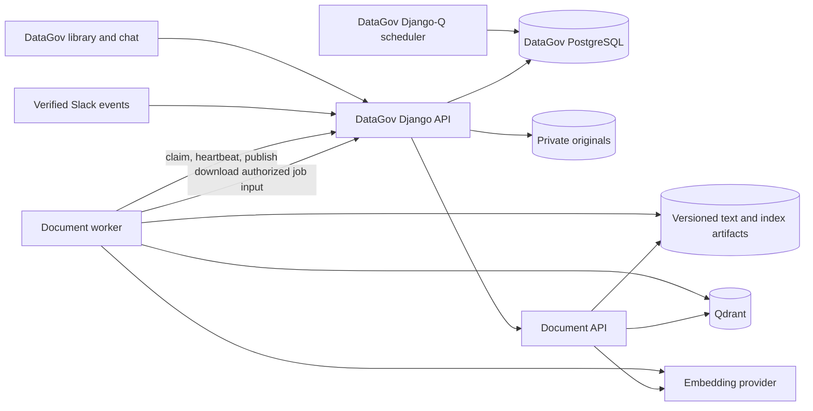

# Document Explorer

Document Explorer adds document ingestion, a searchable library, grounded document chat, and protected citation links to DataGov. The implementation uses a separate Python engine service and worker; DataGov remains responsible for scheduling, authorization, source configuration, job state, and conversations.

The original repository audit and phased design are in [the integration plan](rag-integration-plan.md). The colleague's repository remains separate. Its existing API and standalone pipelines are preserved; DataGov calls the new private `document_explorer` API.

## Service boundaries



| Component | Owns |
|---|---|
| DataGov web and Django-Q | Organization and source permissions, schedules, leased runs, document/version metadata, private downloads, chat history, Slack identity mapping |
| Document API | Retrieval restricted to the organization and exact allowed versions; grounded synthesis and structured evidence |
| Document worker | PDF/text extraction, chunking, redaction, embeddings, immutable indexing, processing progress |
| Qdrant | Persistent vector points scoped by organization and version |
| Private file volumes | Original uploads, immutable extracted/index artifacts, and operator-managed import manifests |

The document worker has no database credentials and does not run a scheduler. The engine is an independent Python 3.13 image. DataGov keeps its Python 3.12 runtime. No additional service is needed for the viewer, citation formatting, or source configuration.

## Independent maintenance and updates

Keep the engine checkout in its own `document-explorer` folder beside the DataGov checkout. Within that repository, `document_explorer/` owns the service code and Dockerfile, `tests/test_document_explorer.py` owns the service regressions, and `.github/workflows/document-explorer-image.yml` owns image releases. Engine source is not vendored into DataGov. The stakeholder can review and release engine changes without editing DataGov's web application.

1. Update the engine through its own branch/review process. Keep `/v1` requests, worker callbacks, and citation identities backward compatible. A breaking contract change requires a coordinated DataGov release.
2. Run the engine tests and build its locked image. Verify ingestion and retrieval against the supported DataGov contract before releasing. Changes to extraction/embedding semantics require fresh document versions rather than mutating published artifacts.
3. Publish through the engine image workflow and record the image digest and source commit. Set only `DOCUMENT_EXPLORER_IMAGE` in DataGov's deployment environment for a compatible engine-only update.
4. Pull and recreate `document-api` and `document-worker` using the Compose overlay. Check health, one ingestion run, and an existing citation. Keep all persistent volumes. Coordinate updates around active jobs; lease expiry recovers interrupted attempts.
5. To roll back a compatible service release, restore the previous image digest and recreate those two services. Storage-format or contract changes need their documented migration/restore procedure; an image rollback alone cannot reverse a data migration.

The DataGov scheduler, source ACLs, PostgreSQL records, private download endpoint, and UI remain DataGov responsibilities throughout engine updates.

## Implemented sources and user flow

1. Open **Document Explorer** and create an upload source or an imported snapshot source. Organization administrators manage sources, schedules, runs, and uploads. Sources are restricted to the creator by default; explicitly select readers/groups or organization access.
2. Upload a text-based PDF (up to 20 MiB), UTF-8 text, or Markdown. The run view reports queued/processing/completed states and failures. Scanned PDFs without extractable text are marked `needs_ocr` instead of pretending to be searchable.
3. Select **Documents** in the existing chat. Answers retain structured evidence, and follow-up questions use bounded authorized conversation history.
4. Open a citation to view the saved version, extracted passage, and PDF page. Copy its DataGov URL to Slack or elsewhere. Login preserves version/page/chunk navigation; the link grants no additional permissions.

Existing standalone Confluence, Jira, Drive, dbt, Power BI and GitHub ingesters are not exposed as live DataGov connectors in this release. Their normalized output can be imported through the snapshot contract below. Live provider synchronization, attachment download, and provider ACL mapping require separate adapters and credentials. OCR is not included. Catalog and Documents are explicit chat modes; automatic blending is not implemented.

## Snapshot contract

An operator places a manifest at `/imports/<organization_id>/<relative-path>` in `document_imports`. The source configuration contains only `{"path":"<relative-path>"}`. Organization directories are enforced by the worker, including resolved-path checks against symlink escapes. User source settings cannot contain credentials or arbitrary host paths.

```json
{
  "documents": [
    {
      "external_id": "provider-stable-document-id",
      "title": "Refund policy",
      "mime_type": "text/plain",
      "source_type": "confluence",
      "source_url": "https://example.atlassian.net/wiki/spaces/POL/pages/123",
      "pages": [{"page": 1, "text": "Cancellations follow the published refund policy."}]
    }
  ]
}
```

Use `text` instead of `pages` for unpaginated documents. A snapshot contains 1–1000 documents and must represent the complete source scope. Stable `external_id` values preserve document identity across updates. Imported text has a DataGov reader and provider link, but no original binary unless it was uploaded through the upload API.

Publication is all-or-nothing for the metadata transaction. A failed document keeps its previous published version searchable. Missing documents are retired only after a fully successful snapshot, and removal of more than 25% of previously published documents is blocked for operator review. Partial/failed snapshots never retire missing documents. A later successful snapshot may restore a document removed by its source; a manual deletion stays deleted.

## Deployment

For GitHub-to-Azure production releases, use the [Azure deployment runbook](azure-deployment.md) and separate `deploy/azure` configuration. It preserves the existing database and storage and supports local or managed Qdrant. The root Compose instructions below remain useful for local/manual operation.

The root [Compose overlay](../docker-compose.documents.yml) adds `document-api`, `document-worker`, and `document-vectors`. It does not expose their ports to the host. The public nginx endpoint rejects the worker protocol; the worker talks directly to `web:8000`. Document originals are not mounted into nginx or served from `/media/`.

Build the engine from its separate checkout:

```powershell
$engineCheckout = "C:\path\to\document-explorer"
docker build -f "$engineCheckout/document_explorer/Dockerfile" -t document-explorer:local "$engineCheckout"
Copy-Item .env.documents.sample .env.documents
```

Fill `.env.documents` with distinct random API, worker, and Qdrant keys; the model provider key; and the public DataGov URL. Set `DOCUMENT_EXPLORER_IMAGE` to the built image. Azure production releases use the ACR digest emitted by the engine's dedicated image workflow, for example `<registry>.azurecr.io/document-explorer@sha256:<digest>`. Do not use the upstream legacy image: it does not contain the new service entry points.

```powershell
docker compose --env-file .env.documents -f docker-compose.yml -f docker-compose.documents.yml config --quiet
docker compose --env-file .env.documents -f docker-compose.yml -f docker-compose.documents.yml up -d --build
```

The existing web entrypoint runs migrations and creates the shared cache table. The document scheduling tick is registered after migrations and runs through the existing DataGov Django-Q worker. Configure an explicit `DATAGOV_DATABASE_TARGET=local` or `production` in `backend/.env`; debug mode need not determine the database target. The feature stays off in deployments that do not enable it.

For a standalone Django deployment, copy the Document Explorer variables from [backend/.env.sample](../backend/.env.sample), and run migrations plus `createcachetable`. Start the engine API and worker using the same image/configuration as the overlay. Keep their HTTP endpoints on a private network.

## Scheduling and failure handling

- Sources support five-field cron expressions with IANA timezones. A minute tick queues due work, coalesces missed schedules into one run, and prevents overlapping runs per source.
- A worker claims a job and receives a rotating lease token. Heartbeats extend the lease. Cancellation and expired attempts cannot publish; stale worker callbacks are rejected.
- Expired leases retry up to three attempts. Terminal failures are visible in DataGov; administrators can retry failed/partial runs. Repeating an upload or completion with the same idempotency key/body does not duplicate publication.
- Published version contents are immutable. Failed replacements keep the old version active, and a retry of an older failed upload cannot replace a newer published upload.
- The model is called once per answer request; an ambiguous timeout is not blindly retried. Service failures return a safe user message without exposing provider errors or keys.

## Permissions and Slack

All library and download requests require an active organization membership and the relevant application access. A source's reader ACL applies before retrieval and again before returning or reopening evidence. Administrators can manage sources but do not automatically bypass a restricted source's reader list. Saved chat answers with revoked evidence are redacted on subsequent reads.

Slack requests require `SLACK_SIGNING_SECRET`, timestamp/HMAC validation, a unique organization workspace binding, and a verified matching bot token. Configure the workspace in Integrations and the stable Slack member ID in the organization member dialog. Mapping requires an active linked DataGov account; clearing the field removes the mapping. Member removal also clears that organization's mapping while preserving governance ownership records. Only a mapped direct-message request prefixed with `/documents` or `documents:` can return document answers. Channel requests and unmapped identities receive a generic DataGov link. DataGov URLs point to the protected viewer; no public file links or attachments are sent. Slack sending has not been exercised against a live workspace as part of local verification.

## Operations and limits

Back up DataGov PostgreSQL, `document_originals`, `document_artifacts`, `document_vectors`, and operator import manifests together. Retain old versions needed by saved citations. Deletion revokes serving/retrieval immediately; physical purging and retention automation are separate operational work. Do not remove volumes during an application rollback. Disable `DOCUMENT_EXPLORER_ENABLED` and stop the document worker before restoring a consistent backup.

The API health endpoint checks required configuration and Qdrant. The worker health check checks its own recent heartbeat; monitor failed runs and queue age in addition to container health. The engine does not validate provider credentials by making a paid call at startup.

Initial limits are 5,000 allowed versions per query, 20,000 lexical chunks or 10 million text/index characters per search scope, and 10,000 question characters. Oversized scopes fail with a controlled service error. This first lexical implementation rebuilds a bounded in-memory search view; larger corpora need a persistent lexical index. PDF extraction is capped at 2,000 pages, with 10,000 chunks and 5 million combined page/chunk text characters per published document. Worker result JSON is bounded at 32 MiB. The engine checks publication limits before embedding each document. Load testing and retrieval quality evaluation against a representative, permissioned production corpus remain necessary before rollout.

## Verification

Local verification uses disposable PostgreSQL and Qdrant, private temporary document volumes, and an explicit test-only engine launcher that substitutes deterministic embeddings and answer generation. Production entry points cannot enable those adapters through an environment flag. No real connector corpus, live Slack messages, paid provider calls, or production database was used.

| Check | Result |
|---|---|
| DataGov backend | 823 distinct tests and 4 subtests covered across the full run and focused reruns; includes 48 knowledge tests and 29 member-management tests |
| PostgreSQL concurrency | Both source-pause/publication orderings and claims during source updates passed |
| Django | System checks clean; no missing migrations |
| Frontend | 212 tests passed; typecheck and production build passed; lint had no errors and 18 existing warnings |
| Document engine | 38 focused service tests passed; the earlier upstream regression run and real-Qdrant tests also passed |
| Deployment configuration | Compose overlay validation and nginx syntax check passed |
| Engine isolation | API/worker ran as UID 10001 with read-only roots; API artifacts read-only; worker artifacts writable |
| Persistence | Restarted disposable Qdrant; the real PDF answer and exact version/chunk/page citation remained identical |
| Snapshot integration | Actual worker ingestion, Qdrant retrieval, persisted citation, follow-up history, source ACL revocation and saved-answer redaction passed |
| Real Chrome browser | Source/ACL/schedule creation, multipart PDF upload, rendered PDF page 2, extracted text, document chat/citation sheet, mobile layout, login preserving version/page/chunk, and another user's document/file denial passed; no JavaScript exceptions |

The acceptance run caught and fixed a nullable upload URL contract mismatch and exercised recovery of the displaced test worker through the guarded failure/retry APIs. Other regressions cover stale leases, cancellation, idempotency, immutable versions, failed replacements, manual deletion races, snapshot tenant isolation and deletion guards, and Slack signature/identity checks. The historical migration test was updated to restore the current schema before invoking current runtime code; its historical migration assertions remain intact.

Ignored local evidence is under `_out/document-e2e-http-result.json`, `_out/document-ui-live/summary.json`, and `_out/document-ui-live/*.png`. These deterministic integration checks establish the service and authorization behavior; they do not establish production retrieval accuracy, provider quota, or capacity.
