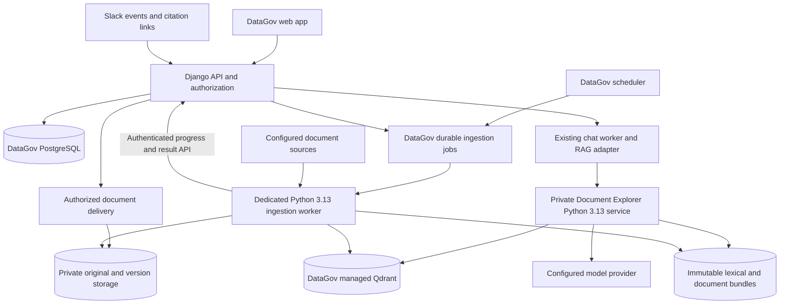

# DataGov Document Explorer integration plan

Prepared on 13 October 2026. This document preserves the historical code audit and the broader implementation plan. Implementation has since begun under the product name **Document Explorer**. Use [Document Explorer operations](document-explorer.md) for the implemented scope, configuration, verification evidence, and deployment instructions; the phases below also include future work. Repository names, commit IDs, and original audit results are retained for traceability.

Deploy the colleague's pipeline and retrieval engine as **Document Explorer**, a private microservice alongside DataGov with its own repository and versioned image. DataGov owns the scheduler, source configuration, pipeline controls, document permissions, conversations, citations, and document viewing. Keep Qdrant as the vector database initially, with persistent storage managed alongside DataGov. Store application records in DataGov PostgreSQL and original documents in private durable storage.

The first complete user journey is: configure a source in DataGov, process its documents, ask a question in the existing chat, and open a citation inside DataGov at the exact document version and page. The same authorized DataGov link should work when pasted into Slack or included in a Slack answer.

## Repository baseline

All three relevant checkouts were fetched with all configured remotes and pruned remote references, then pulled with `--ff-only`. No branches were merged, no local edits were stashed, and nothing was pushed.

| Local folder | GitHub repository | Reviewed main revision | Result |
|---|---|---|---|
| `welcome-data-catalog` | [datagov](https://github.com/welcome-travel-technologies/datagov) | `6bfb0b9290b9cc45c11e1fdaf6538efab04b3aac` | Already current; clean before this documentation |
| `welcome-rag-new` | [luccy](https://github.com/welcome-travel-technologies/luccy) | `b7d806401dc79019cd691c98b884c16dfb585cda` | Advanced 22 commits from `efe22e9`; version 0.19.1; latest commit by Giorgos Korkidis |
| `welcome-rag` | [luccy-revamped](https://github.com/welcome-travel-technologies/luccy-revamped) | `3d6348ce3bdfe9eb5b1343ec3d6ec982363088e2` | Already current; existing demo script edits and two untracked files preserved |

The user confirmed `C:\MyDrive\jdp\welcome-rag-new` as the intended repository. Use its `luccy` main revision above as the implementation baseline. The folder named `welcome-rag` is a separate revamped implementation, useful as a UI reference but not a branch to merge wholesale.

## Checks and limits

| Check | Result |
|---|---|
| DataGov frontend unit tests | 185 passed across 23 files |
| DataGov TypeScript | `npm run typecheck` passed |
| DataGov ESLint | Passed with 18 warnings and no errors |
| DataGov production frontend build | `npm run build` passed; 24 static pages generated |
| DataGov root Compose | `docker compose -f docker-compose.yml config --quiet` passed |
| DataGov backend | All 731 tests passed across the initial run and targeted environment-error rerun, plus 4 subtests, against disposable local PostgreSQL 18 |
| Django system and migration checks | `manage.py check` reported no issues; `makemigrations --check --dry-run` reported no changes |
| Luccy CI at the exact reviewed commit | [Tests run](https://github.com/welcome-travel-technologies/luccy/actions/runs/37809215932): 1,698 passed, 3 skipped, 123 deselected; Ruff and Compose validation passed |
| Luccy published image workflow | [Image run](https://github.com/welcome-travel-technologies/luccy/actions/runs/37809215789) passed |

The machine's global Python initially failed DataGov test collection because its Pydantic installation was incompatible. A separate environment under ignored `_out/rag-audit-venv` was created from `backend/app/requirements.txt`; the global installation was not changed. Tests disable dotenv loading and explicitly target `127.0.0.1:55439`, never the database selected by production settings. The initial isolated run passed 683 tests and 4 subtests; 48 tests hit an inaccessible global pytest temporary folder. Rerunning those 48 with `--basetemp` inside `_out` passed all of them. Django emitted its existing warning about database access during app initialization. Detailed local logs remain under ignored `_out/rag-audit-*.txt`.

Luccy's test results above are existing CI evidence, not a local rerun. Its required Python 3.13 interpreter is not installed locally, and its ingestion uses Linux `fcntl`, Bash, and symlinks. Its CI runs on Linux. No production database, real corpus, connector credentials, paid embedding/model calls, ingestion, Slack posts, or deployment were exercised. Answer quality, production capacity, provider permissions, and live PDF/Slack behavior therefore remain implementation acceptance work.

## Existing implementation and gaps

| Area | What exists | What integration needs |
|---|---|---|
| DataGov runtime | Django 6 / Python 3.12, PostgreSQL 18, Django-Q2, Next.js 15 | A private Linux Python 3.13 Luccy runtime and dedicated ingestion capacity |
| Luccy retrieval | Lexical search plus Qdrant vectors, local reranker, grounding checks, cost caps and quality gates | Preserve the operating point; add trusted organization and document access scope across every retrieval path |
| Embeddings | `gemini-embedding-2`, 768 normalized dimensions; existing vector reuse by chunk text hash | Version model, dimensions, normalization, parser, chunker and redaction in the index manifest and cache key |
| Scheduled sources | Confluence, Jira, dbt and Power BI definitions | Move hard-coded domains/projects/scopes into typed DataGov configuration |
| Drive and GitHub | Standalone ingesters outside the regular refresh; Drive reads a local mount/manifest | Headless authenticated connectors, stable provider IDs, incremental synchronization and permissions |
| PDF | Text extraction concatenates pages | Preserve page locations and private originals; detect scans; add OCR handling and exact citation navigation |
| Slack documents | No Slack ingestion adapter | A separate connector for selected channels, threads and attachments, including edits/deletions/access changes |
| Chat | DataGov owns asynchronous tasks and text history; Luccy offers ask/stream/document APIs | Persist structured evidence and final answer state through DataGov's existing lifecycle |
| Documents | Luccy returns rendered extracted text, heading/passages and external URLs | Versioned DataGov document records, protected original delivery, canonical links and a native viewer |
| Index publication | Staged vector collections and index bundles, canaries, rollback | Publish immutable document text and catalog metadata with the same generation |

Concrete source evidence:

- DataGov [chat models](../backend/app/catalog/models.py), `ChatSession` around line 814 and `ChatMessage` around line 828: sessions have a user but no organization FK; messages lack a first-class citation contract.
- DataGov [views](../backend/app/catalog/views.py), around lines 166, 228 and 795: organization is resolved from membership, the common agent factory is reused, and message responses expose role/content only.
- DataGov [source registry](../backend/app/etl/sources/registry.py), [source API](../backend/app/catalog/views.py) around lines 3665 and 3776: the operational connector paths assume dbt/Fabric and one active source of each type. A document connector cannot simply be added as another label.
- DataGov [chat page](../frontend/app/chat/page.tsx) around lines 11, 110, 136 and 238, and [API types](../frontend/lib/api.ts) around line 1548: citation metadata would currently be discarded.
- DataGov [auth guard](../frontend/components/layout/auth-guard.tsx) around line 19: only the pathname survives a login redirect, losing citation version/page query parameters.
- Luccy `ingest/gemini_embed.py:29`, `retrieve.py:53`, `retrieve.py:986`: the current embedding/chunking/retrieval operating point. Initial migration should not change this tuning.
- Luccy `ingest/gdrive_ingest.py:126`, `:359`, `serving/api/schemas.py:26`: flattened PDF text, missing original Drive URLs, and citation fields limited to ID/title/URL.
- Luccy `serving/api/chat_routes.py:38`: native saved chats explicitly reject PostgreSQL mode. Its optional PostgreSQL store is not a ready-made replacement for DataGov chat persistence.
- Luccy `refresh.sh:239`, `serving/rqb.py:142`, `serving/api/page_routes.py:279`: corpus files mutate before index promotion, while readers use those live files. Failed-refresh consistency needs correction.
- Luccy `ingest/qdrant_index.py:233`, `retrieve.py:973`: source filters exist, but tenant/document ACL fields and filters do not.

Luccy file references above are relative to the reviewed `welcome-rag-new` checkout and pinned commit, not files already imported into DataGov.

## Architecture decision



“The database lives in DataGov” means DataGov deploys, configures, backs up, monitors and restores it. It does not require vectors and relational data to use the same database engine.

| Choice | Benefit | Cost | Decision |
|---|---|---|---|
| DataGov PostgreSQL + private Qdrant + private document storage | Preserves Document Explorer's tested retrieval and promotion machinery; isolates Python dependencies | Operate persistent vector and file stores alongside PostgreSQL | Recommended first integration |
| PostgreSQL with pgvector | One relational/vector engine | Rewrite vector adapter, promotion/health/canaries and benchmark retrieval; verify production extension support | Consider later as a separate measured migration |
| Keep an unrelated external Document Explorer app and call its public endpoint | Small initial API change | Does not bring pipeline ownership, persistence and document UX into DataGov | Insufficient for the requested outcome |

PostgreSQL remains the authoritative store for organizations, permissions, source settings, documents, versions, processing state, chat and citations. Qdrant and lexical bundles are derived indexes. Preserve vectors in validated snapshots to avoid unnecessary re-embedding. Store originals and extracted versions outside public `/media/`.

Keep Document Explorer code, its Python dependency lock, tests and image build in the existing `luccy` repository. DataGov deployment references a released image pinned by immutable digest, with its source commit recorded. Integration changes to the engine are made in that repository; DataGov holds its API client, contracts, application records, UI and deployment configuration. A DataGov deployment must work without adjacent developer checkouts. The root Compose/deployment owns `document-api`, `document-worker`, Qdrant and storage; the browser only talks to DataGov. CI verifies the supported API contract before either application changes its deployed version.

### Scheduler and job ownership

The scheduler stays in DataGov, using its existing Django-Q2 scheduling infrastructure. It can run in a dedicated DataGov container/process, built from the DataGov image. DataGov stores the schedules, source timezones, next-run times, run history, retry policy and cancellation requests in its own PostgreSQL database. Document Explorer has no competing cron job for a DataGov-managed source.

A scheduled tick or Run now action creates a durable job in DataGov and returns promptly. Validate schedule expressions before saving and update schedule registration transactionally, with reconciliation for any mismatch. For the initial protocol, `document-worker` claims authorized jobs through a narrow internal DataGov API, receives an immutable source/configuration version, then reports heartbeat, progress and results through that API. The scheduler does not hold a worker open for the complete extraction/embedding run. Document Explorer has no direct access to Django tables or the Django-Q broker; service identity and per-job scope authorize each claim and callback. The diagram's jobs-to-worker arrow represents this claim protocol.

Dispatch is retryable, so use a unique occurrence key for each scheduled source run and a separate idempotency key for a manual request. Enforce one active run per source transactionally, including when manual and scheduled requests race. Claims have leases and fencing tokens; an expired worker cannot publish or overwrite a newer attempt. DataGov owns whole-job retries and attempts; Document Explorer performs bounded provider-request retries within the claimed attempt. Cancellation remains requested until the worker acknowledges it or its lease expires, and a cancelled attempt cannot publish. A paused source creates no new jobs; handling an already running job is an explicit separate action. Reconcile lost heartbeats and missed status updates after restarts.

For knowledge refreshes, coalesce missed schedule occurrences into one incremental catch-up run by default; use an explicit backfill command for historical ranges. Django-Q2 normally catches up missed schedules, so configure and test the knowledge scheduling path deliberately without changing legacy ETL behavior globally. Persist instants in UTC and define how a source's chosen timezone behaves across daylight-saving changes. Existing catalog ETL locks remain in place. [Django-Q2 schedule behavior](https://django-q2.readthedocs.io/en/master/schedules.html).

### Service boundaries

| Component | Deployment and ownership | Reason |
|---|---|---|
| DataGov web/API and background orchestration | Existing DataGov codebase; separately runnable web and worker/scheduler roles | Keeps login, permissions, schedules, catalog, chat history and document UI under one application owner |
| `document-api` | Private Document Explorer service | Serves retrieval and grounded answers with its own runtime/dependencies |
| `document-worker` | Separate worker container from the same pinned Document Explorer image/release | Gives extraction, OCR and embeddings independent concurrency/memory limits so batch work cannot exhaust chat capacity |
| PostgreSQL, Qdrant and private document storage | Infrastructure services with explicit persistence and backup ownership | Each has a defined storage responsibility; they do not require new custom application services |
| OCR/extraction worker pool | Optional later Document Explorer worker role | Separate when large scans, GPU requirements, parser isolation or measured resource contention justify it |

Keep source adapters together in Document Explorer, and keep authentication, authorization, Slack entrypoints, chat history and document-link routing in DataGov for the first release. A separate repository or HTTP service for each connector, embedding step or UI feature would add contracts, deployments and failure modes without a demonstrated scaling or reuse need. Reconsider an independent document-processing service only if other applications need that API or it develops an independently operated runtime. Code can still be organized into clear modules within these two application codebases.

Qdrant supports tenant payload filtering and collection/shard isolation, but filters must be supplied correctly by the application. Start with an explicitly scoped pilot organization and an isolated corpus/collection generation; a second organization cannot use that corpus accidentally. General multi-organization serving requires per-request index selection and mandatory access filtering in both lexical and vector retrieval. Select shared collections or per-organization collections after measuring tenant count and corpus size. [Qdrant multitenancy documentation](https://qdrant.tech/documentation/tutorials/multiple-partitions/).

## Ownership and access before retrieval

DataGov derives organization and principal from the authenticated request. Neither browser parameters nor LLM tool arguments may select unrestricted tenant IDs or ACL filters. Source toggles narrow an already authorized set; they do not grant permission.

Apply the same scope to vector candidates, lexical candidates, reranking, full-page expansion, deep research, remembered pages, previous answer context, caches, citation metadata, document content, original files, records, feedback and stream reconnects. DataGov checks its authoritative PostgreSQL authorization/deletion state before evidence reaches a model and again before content is delivered; Document Explorer uses trusted request scope and narrow internal authorization checks where needed, without querying Django tables directly. ACL changes invalidate affected caches and remembered evidence; stale or unknown restricted permissions fail closed. A revoked source must not remain readable while waiting for re-embedding.

DataGov must own each chat/run and bind it to one organization. Backfill existing sessions only when membership makes the organization unambiguous; leave ambiguous sessions unavailable for RAG until explicitly resolved. Recheck membership on every access. A disabled feature removes its tools and APIs, not just its sidebar item.

Document Explorer stays on the private service network, with the development UI disabled and service credentials held server-side. Do not expose its shared-key `/records`, `/documents` or job APIs directly. Strip incoming identity headers and replace them with trusted context. Source credentials live in secret references; admin forms do not echo them. Keep warehouse execution subject to DataGov's existing feature flags and read-only permissions.

The existing Slack webhook needs raw-body signature/timestamp verification, installation/workspace-to-organization mapping, event deduplication and explicit invoking-user mapping before private document answers are enabled. A user's read permission does not authorize disclosure to everyone in a channel. Use only evidence approved for the channel audience, or deliver a private result with an authenticated DataGov link. [Slack request verification](https://docs.slack.dev/authentication/verifying-requests-from-slack/).

## Proposed data and API contracts

Add a dedicated Django `knowledge` app/domain. Keep documents separate from catalog `Item` and lineage objects; they have different identity, lifecycle and permission rules.

| Record | Essential fields and invariants |
|---|---|
| `KnowledgeSource` | UUID, organization, kind, provider identity, allowed scope, secret reference, schedule, active state, last completed sync; multiple folders/channels of the same kind allowed |
| `IngestionRun` | UUID, source, idempotency key, status/stage, checkpoint, heartbeat/lease owner, counts, cost, sanitized errors, cancellation; only the lease owner can publish |
| `Document` | UUID, organization/source, unique external ID, title/MIME, canonical source URL, parent attachment/thread, current version, deletion/access state |
| `DocumentVersion` | Immutable original/extracted object keys, content hash, source revision/time, parser/chunker/redaction versions, page map and extraction status |
| `DocumentChunk` | Version, stable chunk ID/order, text reference/hash, section/page/message/span locator; chunk IDs do not depend on their global array position |
| `EmbeddingProfile` | Provider/model, dimension, normalization/distance, input transformation and processing versions; reject incompatible vectors |
| `IndexGeneration` | Organization/corpus, manifest/checksum, immutable document-version mapping, lexical artifact, Qdrant collection, gate outcome and publish/retirement state |
| `DocumentAccess` | Source/document principals/groups/audience, permission revision and freshness; deny overrides index state |
| `RagRun` and `MessageCitation` | Owning organization/user/chat/message, engine job mapping, status/final answer, generation, evidence IDs, abstention/gaps, timings/cost, canonical citation locators |
| `SlackInstallation` | Workspace/enterprise mapping, organization, secret references and explicit user associations |

Enforce uniqueness for `(organization, source, external_id)` and `(document_version, chunk_id, embedding_profile)`. Link ingestion and publication records so crash recovery can identify what was staged, validated and activated.

Suggested public API surface, always through Django:

- `GET/POST /api/knowledge/sources/`, plus test/scope-preview/update endpoints for admins.
- `POST /api/knowledge/sources/{id}/sync/`, returning an owned run ID; explicit incremental/full mode.
- `POST /api/knowledge/uploads/` for authorized admin multipart uploads in the first release, returning a document/version and run ID; a future private object-store upload requires a server-validated completion step before processing.
- `GET /api/knowledge/runs/{id}/`, and idempotent cancel/retry actions with appropriate admin permission.
- `GET /api/knowledge/documents/` and `GET /api/knowledge/documents/{id}/?version=...` for authorized metadata/excerpts.
- `GET /api/knowledge/documents/{id}/content/?version=...` for authorized range-capable file delivery; original download is a separate permission.
- Existing chat endpoints extended with durable run state and structured citations. Avoid creating a competing public Document Explorer chat API.

An illustrative citation payload:

```json
{
  "citation_id": "c1",
  "document_id": "<document UUID>",
  "version_id": "<immutable version UUID>",
  "chunk_id": "<stable chunk ID>",
  "source_type": "slack",
  "mime_type": "application/pdf",
  "title": "Operations guide.pdf",
  "locator": {"page": 7, "section": "Refunds"},
  "datagov_url": "/knowledge/documents/<id>?version=<version>&page=7&chunk=<chunk>",
  "source_url": "<validated provider URL or null>",
  "excerpt": "<authorized evidence excerpt>"
}
```

Generate the internal URL from trusted records, never from answer text. Validate external URL schemes. Slack uses the absolute form built from a configured public DataGov origin. The link contains no credential or permission grant. Warehouse citations use a separate type and an authorized query/asset detail view; do not fabricate a PDF/document link for `wh:` evidence.

## Implementation phases

### 1 Establish contracts and the isolated stack

Select the image built from the reviewed Document Explorer commit in its existing repository and pin its digest in DataGov deployment configuration. Inventory the actual available corpus snapshot, model files, collection sizes, source scopes and deployment resources. Confirm reuse provenance, API compatibility and storage/backup ownership. Add private runtime services and health checks with the feature disabled. Preserve existing DataGov web/ETL behavior, retain the scheduler in DataGov and keep Document Explorer ingestion separate from interactive chat capacity.

Separate database targeting from `DEBUG` before production integration, or provide an equally explicit enforced deployment target guard. The current setting selects production for `DEBUG=False`, which is unsafe to rely on during migration/testing. Verify the final target without logging credentials.

Deliverable: one reproducible DataGov development stack, explicit service/storage boundaries, source/principal/citation contracts, and a documented route to import a snapshot. Runtime readiness distinguishes database connectivity, available corpus, ready vector collection and available model configuration.

### 2 Add durable metadata and safe publication

Create additive Django migrations for the knowledge records, organization-bound chat sessions and citations. Implement private file storage shared by authorized delivery and ingestion. Configure bounded upload/download size, parser timeouts, content-type validation and isolation for malformed documents. Original binaries may contain content removed from the RAG text; preview/download permissions must enforce the chosen source policy rather than bypass redaction through the viewer.

Use a durable job/outbox and lease protocol. Django schedules jobs; a dedicated Python 3.13 worker claims them through a narrow authenticated internal interface, reports heartbeat/stage/results and completes them idempotently. Do not give the Django web process a Docker socket or accept user-provided shell commands. Preserve the existing catalog ETL filesystem lock; knowledge jobs use unique staging directories and their own source/corpus publication locks.

Version each corpus's canary set with its manifest. Existing Document Explorer Qdrant canaries name legacy page IDs and fail when none are present (`ingest/qdrant_index.py:313`). Preserve source/legacy-to-DataGov ID mappings for replay, and bootstrap meaningful source-specific gates for a new PDF-only pilot. An entirely skipped gate set is not success; unexpected loss of expected documents must fail validation.

Publish in this order: stage immutable document versions and lexical/vector artifacts → validate completeness/permissions/gates → mark generation ready → switch the authoritative active-generation pointer → retain old generations used by in-flight answers and rollback. Readers pin one explicit manifest and collection. Qdrant alias changes and filesystem pointer changes are not a distributed transaction; startup reconciliation must recover interrupted transitions from recorded state.

Deliverable: a failed or cancelled refresh cannot change live document text, vectors, or citations; concurrent manual/scheduled runs cannot publish over each other. Access revocation still takes effect immediately and independently of generation rollback.

### 3 Move ingestion into DataGov controls

Adapt the existing ingesters behind typed source configuration. Remove hard-coded source domains, projects, space/channel lists, repository IDs and warehouse project assumptions from the integration path. Keep the current redaction, chunking, embedding, rerank and grounding defaults for parity.

Pipeline stages are discover → fetch → extract → redact → chunk → embed → index → validate → publish. Record per-source/per-document counts and errors. Reuse unchanged vectors only when content and the complete embedding/processing profile match. Bound concurrency, retries, spend and token budgets; respect provider backoff. Checkpoint pagination and document processing so retrying a run does not duplicate work or spend.

Deletion reconciliation uses a completed source enumeration as evidence. Partial listing, credentials errors, rate limits or an unavailable folder must not be interpreted as deleting every document. Preserve the existing excessive-deletion guard and expose it as an admin review state. Show partial success honestly; a promoted generation does not mean every source synchronized successfully.

Deliverable: an admin can configure scope, test a connection, trigger/schedule a run and inspect why each source/document is indexed, unchanged, skipped, stale or failed. Existing Fabric/dbt connector assumptions remain isolated from this new domain.

### 4 Complete PDF and source provenance

Implement headless Drive access instead of depending on a local synchronized drive. Persist stable file IDs, actual source URLs, modified/revision metadata, supported native-document exports and source access rules. Schedule GitHub/Drive ingestion explicitly where enabled.

For PDF extraction, preserve page numbers, reading order and text-to-page spans; store bounding boxes where the parser supports reliable highlights. Detect image-only/scanned and password-protected PDFs. Put scans through a separately budgeted OCR stage; until configured, report `needs_ocr`, never successful empty ingestion. Keep extracted-text fallback and report when a citation cannot be mapped precisely.

Provide an admin Upload PDF action using a managed upload source. Authorize the target organization/source before accepting bytes, enforce size/type limits, store the original privately, calculate its checksum and enqueue processing. An exact repeat in that source returns the existing document/version; replacing a selected document creates a new immutable version. Avoid cross-tenant content-deduplication disclosures. Return the user to the library row with queued/processing/ready/needs-OCR/failed status and a safe retry action.

For Slack content, add an explicit adapter rather than treating unknown sources as Jira: workspace → selected channels → threads/messages → attachments. Index useful thread context; map an attached PDF to its file record and parent message. Support edits, deletions, membership changes, pagination, retention limits and rate limiting. Do not ingest private channels or direct messages implicitly. Determine the app's applicable API limits before estimating backfill duration. [Slack rate limits](https://docs.slack.dev/apis/web-api/rate-limits/).

Deliverable: a PDF from an upload, Drive or an authorized Slack attachment has one stable DataGov document link and accurate version/page provenance. Slack ingestion is a distinct milestone from displaying DataGov links in Slack answers.

### 5 Connect the existing chat to authorized RAG

Add a knowledge provider to the existing common agent factory, with an organization-level feature flag and server-bound principal. For the initial compatibility path, call Document Explorer's answer pipeline as a bounded internal tool and retain its grounding checks. Treat its final answer and citation set as a validated unit; if an outer agent rewrites factual claims, validate the final displayed claims again or display the checked RAG answer directly. Do not assume citations remain valid after arbitrary summarization.

For mixed catalog/document questions, route each part explicitly: document definitions/processes through RAG, existing catalog/lineage tools through DataGov, and live numbers only through authorized warehouse tools. Do not silently enable Document Explorer's hard-coded warehouse project alongside DataGov's live query tools. Avoid nested unbounded agent loops and duplicate SQL execution.

Persist DataGov-owned run IDs, idempotency keys, final messages, citations, generation, abstention/gaps and diagnostic metadata. Namespace engine conversations from the authorized DataGov session. Revalidate remembered evidence and prior context after access changes. Do not adopt Document Explorer's separate file chat tree or optional PostgreSQL conversation sidecars as the app's conversation database.

Retain DataGov's existing polling/resume behavior first. Translate Document Explorer's stage events into durable run updates; optionally expose an owned resumable event stream later. An early answer may be corrected by Document Explorer's checks, so distinguish provisional and final state and persist the corrected version. Engine restarts produce an explicit interrupted state or a safely resumed run. Never blindly replay a timed-out paid request.

Start with one engine serving process per isolated pilot corpus; Document Explorer's jobs are process-local. Multiple replicas require shared job/event persistence or explicit routing before reconnect can be reliable.

Deliverable: document-only and mixed questions produce authorized, grounded answers with persisted citations, while current Power BI/dbt chat continues working.

### 6 Build the document and citation experience

Add a Knowledge library with provider/type filters, title search, source freshness and document status. Add `/knowledge/documents/{id}` as the canonical page and reuse the same reader in a chat side panel. This route opens independently of the original chat and never exposes the private conversation to other document readers.

The answer shows compact numbered references and source cards with recognizable provider/file icons, title and page/section. Clicking opens DataGov at the cited version and passage. A secondary action opens the original provider. PDF view supports page jump, zoom, text selection and permission-aware download. Slack sources render thread context and attachment cards. Mobile uses a full-width sheet/page; desktop supports a resizable panel.

Preserve version/page/chunk through login and organization selection, accepting only safe internal return paths. Opening a citation from Slack while logged out should return to the exact PDF page after login. Show clear states for loading, retry, access denied, deleted source, old cited version, unsupported preview, missing original and unavailable precise highlight. Do not substitute the latest text silently.

Keep DataGov's ReactMarkdown safety boundary; do not inject Document Explorer's returned HTML into the app. Prevent external embedded content from leaking document context. Source switching must cancel or ignore stale responses. Provide keyboard activation, visible focus, Escape/return focus, accessible panel controls and readable tables/code on mobile.

Deliverable: citation → DataGov reader is complete across web chat, refreshed history, copied links and Slack links, with no browser access to Document Explorer/Qdrant credentials.

### 7 Enable Slack answers and operational controls

Harden the existing Slack entrypoint and bind installation, user and channel audience before enabling RAG. Acknowledge events promptly and process them asynchronously; deduplicate retried events. Add source links/buttons built from DataGov's citation records, with accessible fallback text. Do not post private evidence or revealing titles into a broader channel merely because the requester can read them.

Add a Knowledge section in Integrations with typed forms, connection/scope checks, schedules, latest successful sync, stages, counts, estimated/actual spend, retries and cancellation. Put detailed diagnostics in admin views; the chat user sees meaningful statuses such as searching sources and checking evidence. Add queue pressure, stale-source, permission-sync failure, disk and index readiness alerts.

Deliverable: Slack answers reliably open DataGov sources, and admins can operate the full pipeline without shell access.

### 8 Migrate and roll out with measured parity

Restore a checksum-verified corpus snapshot into new DataGov-owned storage where available; do not wipe or mutate the colleague's running corpus. Import document identities and immutable versions, bind the pilot organization, map access, and rebuild derived payloads/lexical metadata as needed. Reuse vectors only when the manifest and profile prove compatibility; regenerate changed PDF chunks where adding page provenance alters chunking.

Validate counts, hashes and a sampled set of citation paths against the source snapshot. Replay the colleague's retrieval canaries and representative gold questions through the preserved source-ID mapping for the matching corpus; use the new manifest's scoped canaries for a smaller/new corpus. Document the baseline for answer quality, retrieval latency, cold start, memory and spend. Shadow the new path without showing answers, then enable one organization and a limited source scope. Expand only after authorization, recovery and UI checks pass.

Back up PostgreSQL metadata, private objects, manifests and compatible vectors together. Restore into an empty environment and prove that document/citation relationships still resolve. Configure retention for originals, indexed text, logs, old generations and answer references. Deletion/revocation overrides historical citations; retained versions are never an authorization bypass.

Rollback is: disable RAG chat, stop new refresh publication, return to the previous validated generation, and keep legacy catalog chat available. Do not drop additive tables or reset existing catalog data. An index rollback must preserve the current deletion/permission deny state. Revert service images and manifests together when their schema/profile changes are incompatible.

Deliverable: a repeatable deployment, migration, rollback and restore procedure with an explicit launch checklist.

## Acceptance checks

| Area | Required evidence before rollout |
|---|---|
| Existing behavior | Backend chat/tenant/ETL tests, frontend tests/types/lint/build; no regression in catalog, dbt/Fabric runs or existing chat |
| Isolation | Cross-org guessed IDs, wrong user/session/run, forged engine headers, stale permissions, revoked membership and source toggles cannot expose evidence, previews, originals or history |
| Retrieval | Authorization enforced in vector, lexical, full-page, deep and remembered-context paths; malicious document instructions cannot change tool permissions |
| Grounding | Final citations resolve to evidence actually used; no invented document/page IDs; unsupported questions abstain and partial answers disclose gaps |
| Files | Text PDF, scan, malformed/encrypted file, Unicode filename, duplicate upload, changed revision, unsupported native export and large file behave explicitly |
| Pipeline | Incremental no-op avoids embedding; retries/resume are idempotent; partial enumeration causes no mass deletion; cancellation/crash cannot publish incomplete state |
| Scheduling | Duplicate delivery creates one logical scheduled run; missed runs coalesce; overlapping manual/scheduled runs respect locks; expired/cancelled attempts cannot publish; DataGov/Document Explorer outages recover through durable state |
| Publication | Crash between pointer operations and failed gate leave readers on a coherent generation; old in-flight answers remain version-consistent; restore succeeds |
| Slack | Bad/expired signatures, duplicate events, wrong workspace, unmapped user and broader channel audience cannot disclose documents; edited/deleted threads and attachments synchronize |
| Links and UI | Web/Slack citation opens the correct version/page before and after login; refresh/history retain citations; rapid switching, keyboard and mobile flows work |
| Performance and cost | Measure p50/p95 retrieval/end-to-end latency and peak RAM on target hardware; ingestion load does not starve chat; cold-model behavior and caps/retries are visible |

Add real PostgreSQL/Qdrant integration tests and browser tests for the citation/login/viewer journey. Keep routine CI hermetic with fixture documents, fake provider responses and local vector services. Run paid quality evaluations only as explicit, capped deployment/evaluation work with the agreed corpus.

## Work breakdown and decisions

Suggested review units: (1) isolated services and contracts, (2) schema/private storage/permissions, (3) durable ingestion and coherent publication, (4) PDF/Drive provenance, (5) chat adapter and citations, (6) Knowledge UI/viewer, (7) Slack hardening and connector, (8) migration/evaluation/operations. Each change should be independently testable with the feature disabled. UI work can run alongside ingestion once the document/citation contract is fixed; Slack ingestion can follow the first working PDF-and-chat journey.

The accepted architecture is a private Document Explorer microservice in its existing repository, deployed through a pinned image alongside DataGov. Initial implementation defaults are the reviewed upstream `luccy` commit `b7d8064`, separate Document Explorer serving/ingestion roles, the scheduler and application PostgreSQL records owned by DataGov, Qdrant and private document storage inside the managed deployment, and one explicitly authorized pilot organization/source scope. Production inputs still needed are the deployment capacity/storage location, a source snapshot or backfill scope, and the document audience policy. These affect rollout, not the ability to build the foundation.

If “database there” specifically means a single PostgreSQL engine, evaluate pgvector in a separate storage spike before implementing the vector adapter. If “PDF in Slack” means only that Slack answers link to PDFs in DataGov, the Slack history ingestion milestone can be omitted; stable document links and safe Slack answer delivery remain required.
